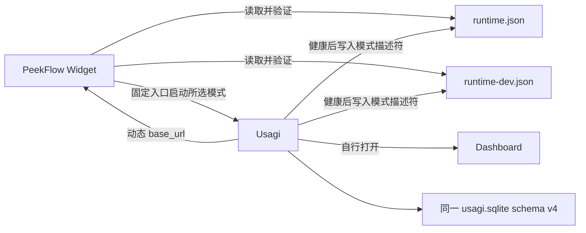

# Usagi 与 PeekFlow Widget 接入实施方案 v0.1

> - 基线仓库：`/Users/hogee/Desktop/Usagi`
> - 基线分支：`magpie-companion-spec05`
> - 基线提交：`bf8216a`
> - 数据库版本：当前源码 schema v4
> - 方案状态：已冻结（本轮用户需求）
> - 正式版入口：已安装的 `Usagi.app`；未安装时明确提示，不回退仓库二进制

# 1. 文档目的

- 让 PeekFlow 发现正式版与开发版的实际服务地址，并连接用户选择的版本
- 让 Widget 从断开状态启动所选 Usagi，并由 Usagi 打开 Dashboard
- 保持 Public API v1 六个接口及 Widget 现有指标、费用、额度和数据展示文字

# 2. 代码现状与问题

## 2.1 运行模式与端口

`internal/app/ports.go` 定义正式版端口段 `37891–37922` 和开发版端口段 `37991–38022`。两个构建模式各扫描 32 个回环端口。

build-tag 文件分别提供 `production`、`development` 模式值和对应端口段。两种模式都在健康检查成功后原子写入描述符，分别使用 `runtime.json` 和 `runtime-dev.json`；描述符包含 `schema_version`、`pid`、`port`、`base_url`、`runtime_mode`。

`BindLoopback` 先检查 `/api/health` 的成功状态和 `X-Usagi-App: Usagi` 标记，再通过 `/api/v1/info` 确认已运行服务的 `runtime_mode` 与当前构建模式一致。

## 2.2 数据库与构建入口

两个模式从描述符所在目录打开同一个 `usagi.sqlite`。SQLite 使用 WAL 和 5 秒 busy timeout。开发版使用本机当前源码；正式版只通过 PeekFlow 启动已安装的 `Usagi.app`。仓库 `dist/usagi` 仅作 production 构建验收产物，不是正式启动入口。

两版可同时运行，并使用同一数据库路径和现有 SQLite WAL/忙等设置；本次不隔离数据库，也不改造数据库访问。用户安装的 `Usagi.app` 必须与当前 schema v4 源码配套；不支持旧二进制与新 schema 混跑。

此前仓库 `dist/usagi` 来自提交 `e1404ee`，只支持 schema v1–v3；当前源码增加了 v3 到 v4 的迁移。本轮已将 `dist/usagi` 从当前工作树构建为 production 验收产物。旧安装版不能与新 schema v4 源码共库运行；正式启动只使用与当前源码 schema 配套的已安装 `Usagi.app`。本机未安装该 app，本轮不安装或重签名旧 app。

`scripts/build_macos_runtime.sh` 是 production Go 构建入口，用于本次构建验收；它构建前端资源并以 `-tags production` 生成 `dist/usagi`，不会安装或签名 `Usagi.app`。开发版由 `go run ./cmd/usagi` 启动；`internal/webui/dev.go` 从工作目录下的 `frontend/dist` 读取资源。

## 2.3 Public API 与错误响应

`GET /api/v1/info` 当前返回 `service`、`app_version`、`api_version` 和 `capabilities`。Public API v1 六个路径与现有 DTO 已冻结。

首次 Usage 同步完成前，`GET /api/v1/usage/summary` 返回 HTTP 503 和 JSON 正文 `{"error":"DATA_LOADING"}`。PeekFlow 当前客户端丢弃非成功响应正文，不能区分可恢复的数据加载状态。

# 3. 目标架构与范围边界

## 3.1 目标效果与终态

两个构建模式写入各自的运行时描述符，并继续使用同一个 schema v4 数据库。PeekFlow 只读取两个已知描述符；它不扫描端口，也不从描述符读取可执行路径。Widget 正式版通过系统应用发现启动已安装 `Usagi.app`，开发版通过固定源码命令启动。Usagi 绑定动态端口、完成健康检查、写入描述符并打开 Dashboard；Widget Dashboard 工具栏继续打开已验证服务的 `base_url`。



## 3.2 范围矩阵

| 维度 | 纳入范围 | 严格排除 |
|---|---|---|
| Usagi 运行时 | `internal/app` 描述符、构建模式、端口探测和相关测试 | 查询、数据库、projection、健康接口语义 |
| Public API | `GET /api/v1/info` 增加 `runtime_mode`；更新当前 Public API 契约段与响应测试 | 其他接口、路径、`api_version`、capabilities、状态、额度和费用语义 |
| PeekFlow | 现有 Usagi 发现、连接、启动模式菜单、正式版缺失提示、工具栏地址、错误体解析和对应定向测试 | 指标、费用、额度数据及展示，和本次无关的文案或 UI 信息 |
| 构建与文档 | production Go 构建验证（`dist/usagi` 仅作验收产物）；更新相关 README 段和本方案 | 安装、重签名、发布和自动安装；Widget 不以 `dist/usagi` 为正式入口 |
| 数据兼容 | 两模式共享当前 schema v4 数据库 | 旧二进制兼容、数据库隔离、迁移回退 |
| 发现方式 | 只读两个模式描述符 | 固定端口、端口扫描兜底、任意外部命令路径 |

# 4. 架构契约与核心不变量

## 4.1 全局不变量

- [INV-01] 正式版只写 `~/Library/Application Support/Usagi/runtime.json`；开发版只写同目录的 `runtime-dev.json`
- [INV-02] 两个描述符均使用 schema version 1，并含正整数 PID、1–65535 端口、规范回环 URL 和构建模式
- [INV-03] `base_url` 必须等于 `http://127.0.0.1:<port>`，不含用户信息、查询、片段或非根路径
- [INV-04] `runtime_mode` 只允许 `production` 或 `development`；同一模式的描述符、`GET /api/v1/info` 和实际构建模式必须相同
- [INV-05] 正式版只拥有 `runtime.json`；开发版只拥有 `runtime-dev.json`，不得清理或覆盖另一模式的描述符
- [INV-06] 两个模式继续使用同一目录下的 `usagi.sqlite`；已安装正式 app 必须与当前 schema v4 源码配套，旧二进制不兼容
- [INV-07] PeekFlow 只读取两个固定描述符，并用健康检查和 `GET /api/v1/info` 验证服务；描述符内容不能控制启动命令
- [INV-08] 手动选择启动某模式时，Widget 只等待并连接该模式；失败时不得静默切换到另一模式
- [INV-09] Public API v1 保持六个路径、响应字段、`api_version` 和现有 capabilities 不变；只给 `info` 增加 `runtime_mode`
- [INV-10] 本次不改变 Widget 的指标、费用、额度数据及其展示文字；授权新增启动菜单「正式版」「开发版」，正式版 app 未安装时显示必要提示「未安装 Usagi」

## 4.2 描述符数据契约

正式版与开发版使用同一 JSON 形状，模式值与文件名匹配：

```json
{
  "schema_version": 1,
  "pid": 12345,
  "port": 37891,
  "base_url": "http://127.0.0.1:37891",
  "runtime_mode": "production"
}
```

正式版将 `runtime_mode` 写为 `production`。开发版将其写为 `development`。描述符文件权限为 `0600`，父目录权限为 `0700`。两份文件位于同一目录，因此数据库路径不变。

## 4.3 Public API 与启动入口契约

`GET /api/v1/info` 响应示例：

```json
{
  "service": "usagi",
  "app_version": "0.2.6",
  "api_version": "1",
  "capabilities": [
    "revision",
    "revision-events",
    "status",
    "codex-quota",
    "usage-summary"
  ],
  "runtime_mode": "production"
}
```

Widget 验证 `service`、`api_version`、现有五项 capabilities 和 `runtime_mode`。其他五个 Public API 接口及 `info` 的既有字段保持原样。

正式版只由 PeekFlow 通过 `NSWorkspace` 按 Usagi bundle 身份或在 `/Applications`、`~/Applications` 中发现并启动已安装的 `Usagi.app`。未找到时明确提示未安装并留在断开状态；不启动、不回退仓库的 `dist/usagi`。开发版入口为 `/bin/zsh -lc 'exec go run ./cmd/usagi'`，工作目录固定为 `/Users/hogee/Desktop/Usagi`。GUI 分别设置可执行文件、参数和工作目录，不将仓库路径插入 shell 命令，也不修改全局 shell 配置。

首次 Usage 同步未完成时，Public Summary 继续返回：

```http
HTTP/1.1 503 Service Unavailable
Content-Type: application/json; charset=utf-8

{"error":"DATA_LOADING"}
```

Widget 保留非 2xx 响应正文，并把首次请求和恢复请求中的 `DATA_LOADING` 作为可恢复 loading 状态处理。现有重试间隔和已有有效快照的 15 秒 stale 策略保持不变；不增加数据状态界面文字。

## 4.4 Widget 连接转移

| 当前状态 | 事件 | 目标状态 | 判定与行为 |
|---|---|---|---|
| 断开 | 自动发现 | 已连接 | 先验证正式版；无效或不可达时再验证开发版 |
| 已连接 | 当前服务失联 | 自动恢复 | 先尝试上次成功模式，再尝试另一模式 |
| 断开 | 用户选择模式 | 启动中 | 重查该模式描述符，再调用该模式固定入口 |
| 启动中 | 描述符、健康检查、info 和 bootstrap 验证成功 | 已连接 | 只连接所选模式；启动操作期间禁止另一模式抢连 |
| 启动中 | 60 秒超时，或进程非零退出且目标模式没有有效服务 | 断开 | 保留现有断开视图，不新增提示文字；操作结束后恢复正常双模式发现 |
| 启动中 | 入口进程以 0 退出 | 启动中或已连接 | 0 可能表示 Usagi 复用既有实例并正常退出；继续 bootstrap 所选模式，不直接判失败 |
| 启动中 | 正常服务进程长期存活 | 已连接 | 服务进程持续运行属于正常情况 |
| 启动中 | 重复点击 | 启动中 | 禁用重复启动；仅对本 Widget 已启动且仍 pending 的子进程复用等待，不阻止正常既有服务走标准入口 |

显式模式选择优先于自动恢复任务。协调器取消或作废旧恢复任务，并用任务代号拒绝过期回调。选中模式操作失败或超时并结束后恢复正常双模式发现；不得在该操作中连接另一模式。

# 5. 施工路线与任务分工

## 5.1 实施阶段与门禁

| 阶段 | 内容 | 前置依赖 | 门禁 |
|---|---|---|---|
| Phase 1 | Usagi 写入模式描述符，并通过 info 暴露模式 | 本方案冻结 | 默认与 production 定向测试 |
| Phase 2 | PeekFlow 验证发现、启动、恢复和错误体 | 公共契约冻结 | Usagi/CodexUsage 定向测试 |
| Phase 3 | 更新文档并构建 production 验收二进制 | Phase 1 完成 | Public API 契约检查与 production 构建；不安装或签名 app |

## 5.2 任务分工与所有权

| 执行单元 | 职责 | 独占范围 |
|---|---|---|
| Usagi subagent | 描述符、模式探测、info、README、Public API PRD、production 构建验收 | `internal/app` 运行时文件及测试、`internal/api` info DTO 与测试、指定文档和构建产物 |
| PeekFlow 现有主会话 | Widget 发现、启动、连接恢复、工具栏 URL、错误解析与定向测试 | PeekFlow 现有 Usagi/CodexUsage 集成文件与对应测试 |
| 总工程师 | 审查方案并冻结 | 方案冻结；不代写两侧产品代码 |

## 5.3 路线与实施步骤映射

| 阶段 | 负责方 | 对应步骤 | 验收 |
|---|---|---|---|
| Phase 1 | Usagi subagent | 6.1–6.2 | 默认与 production 的 app 和 PublicV1 定向测试通过 |
| Phase 2 | PeekFlow 现有主会话 | 6.3 | 启动、发现、恢复和 DATA_LOADING 定向测试通过 |
| Phase 3 | Usagi subagent | 6.4 | README、Public API PRD 更新；production 验收产物从当前源码构建 |

Phase 2 只依赖本方案冻结的公共契约，可与 Phase 1 并行施工；跨仓最终验收依赖 Phase 1 完成。

# 6. 详细实施步骤

## 6.1 增加构建模式描述符（Phase 1）

### 6.1.1 写入两个模式的描述符

- 目标文件：修改 `internal/app/discovery.go`、`internal/app/ports.go`、`internal/app/ports_production.go`、`internal/app/ports_development.go`、相关测试
- 遵循契约：`[INV-01]`–`[INV-06]`
- 在构建标签文件提供固定模式值
- 让 `RuntimeDescriptorPath` 按模式返回 `runtime.json` 或 `runtime-dev.json`
- 让开发版和正式版都启用描述符写入
- 保持描述符父目录、数据库文件名、端口段和权限规则不变
- 健康检查成功后原子写入完整 JSON
- 正常退出时仅当 PID 与模式仍匹配才删除本模式描述符
- 更新默认构建和 `-tags production` 下的路径、字段、权限及清理测试

### 6.1.2 按模式复用运行实例

- 目标文件：修改 `internal/app/launcher.go`、`internal/app/app.go` 及相关测试
- 遵循契约：`[INV-03]`、`[INV-04]`、`[INV-05]`、`[INV-08]`
- 对占用端口先请求现有健康接口，再请求 `/api/v1/info`
- 只有 `runtime_mode` 与当前构建模式一致时才复用服务并打开其 Dashboard
- 模式不匹配或 info 无效时，不把该服务当作所选模式
- 保持正式版和开发版各自现有的 32 端口范围
- 不在 Widget 中扫描端口，也不增加固定端口兜底
- 启动入口进程以 0 退出时仍验证并 bootstrap 所选模式；只有非零退出且目标模式无有效服务时才判定启动失败

## 6.2 在 info 中暴露构建模式（Phase 1）

### 6.2.1 扩展 Public API info

- 目标文件：修改 `internal/api/dto_public_v1.go`、`internal/api/public_v1.go`、`internal/api/public_v1_test.go`
- 遵循契约：`[INV-04]`、`[INV-09]`
- 在 `api/server.go` 的 `Config` 增加字符串 `RuntimeMode`；`internal/app` 按当前 build mode 传入，不增加共享包或循环 import
- 在 info DTO 增加 `runtime_mode`，值来自 `Config.RuntimeMode`
- 更新 info 响应测试，断言模式值以及现有路径、字段、版本和 capabilities
- 不修改其他接口的 DTO 或处理器

## 6.3 接入 Widget 发现与启动（Phase 2）

### 6.3.1 验证描述符并连接动态服务

- 目标文件：PeekFlow 现有 Usagi/CodexUsage 发现、连接、API client 和定向测试文件
- 遵循契约：`[INV-01]`、`[INV-02]`、`[INV-04]`、`[INV-07]`、`[INV-08]`
- 只读取 `runtime.json` 和 `runtime-dev.json`
- 拒绝 schema、模式、PID、端口或 URL 校验失败的描述符
- 通过健康接口和 info 验证目标服务及模式
- 初次自动发现按正式版、开发版顺序检查
- 保持已有成功连接；服务失联后按上次模式、另一模式顺序恢复
- 所有 Public API 请求和 Dashboard 工具栏链接使用已验证的 `base_url`

### 6.3.2 启动用户选择的模式

- 目标文件：PeekFlow 现有断开按钮、启动协调器、进程管理和定向测试文件
- 遵循契约：`[INV-07]`、`[INV-08]`、`[INV-10]`
- 断开按钮只显示「正式版」和「开发版」两个启动选项
- 点击后先重新发现所选模式，再调用该模式的固定入口
- 即使该模式已有健康服务，也调用标准入口；由 Usagi 复用实例并打开 Dashboard
- 开发入口调用固定 shell 命令，并把仓库根目录作为进程工作目录
- 正式版只查找已安装 `Usagi.app`；未找到时留在断开视图并显示提示标题「未安装 Usagi」
- 绝不从仓库 `dist/usagi` 启动或回退；开发版启动前检查 `frontend/dist/index.html` 存在
- 开发资源缺失时不启动进程，保留现有断开视图
- 最多等待 60 秒，只接受所选模式的描述符、健康检查、info 和 bootstrap
- 启动等待期间禁用重复点击；协调器不得并行运行针对另一模式的恢复和选中模式启动
- 超时后只保留本 Widget 启动且仍存活的 pending 子进程句柄；再次点击只等待或重新验证该实例，不重复启动
- 解析 HTTP 错误正文；将 HTTP 503 与 `{"error":"DATA_LOADING"}` 作为可恢复 loading
- 首次和恢复请求中的 DATA_LOADING 不进入通用 `apiError`；沿用当前恢复间隔和已有有效快照 15 秒 stale 策略，不增加数据状态界面文字
- Widget 的启动流程不调用打开浏览器 API；Dashboard 工具栏仍按现有行为打开已验证的 `base_url`

## 6.4 更新契约文档并构建验收产物（Phase 3）

### 6.4.1 更新 Usagi 文档

- 目标文件：修改 `README.md`、`docs/Usagi_Public_API_v1_产品需求文档.md`
- 遵循契约：`[INV-06]`、`[INV-09]`
- README 更新 macOS 正式与开发启动入口、两模式描述符动态发现、Public API 根地址，并移除固定 `3210` 地址说明
- Public API PRD 更新两模式发现契约、info 的 `runtime_mode` 字段和两种取值，并移除固定 `3210` 地址说明
- 不改六个接口的其他路径、能力或响应定义

### 6.4.2 构建 production 验收二进制

- 目标文件：构建 `dist/usagi` 作为 production 模式验收产物；Widget 正式入口仍为已安装 `Usagi.app`
- 遵循契约：`[INV-06]`
- 运行 `./scripts/build_macos_runtime.sh`
- 检查 `dist/usagi` 是 macOS arm64 production 构建
- 确认二进制由当前工作树生成；不启动、安装、替换或签名该产物

# 7. 测试与机器验收

## 7.1 自动化测试

1. 默认构建运行 app 定向测试：`go test ./internal/app -run 'TestRuntimePort|TestRuntimeDescriptor|TestBindLoopback|TestProbeUsagiHealth|TestRun'`
2. production 构建运行同组测试：`go test -tags production ./internal/app -run 'TestRuntimePort|TestRuntimeDescriptor|TestBindLoopback|TestProbeUsagiHealth|TestRun'`
3. 默认构建运行 PublicV1 测试：`go test ./internal/api -run '^TestPublicV1'`
4. production 构建运行 PublicV1 测试：`go test -tags production ./internal/api -run '^TestPublicV1'`
5. 使用 `t.TempDir()` 设定隔离 HOME；测试不得打开真实用户数据库
6. 使用注入的小范围临时 loopback 端口和隔离 HOME，不探测或占用本机用户的生产端口；验证健康接口、info、描述符端口和 `base_url` 一致；干净停止后占用刚释放的旧 fixture 端口，再启动同一模式；断言服务绑定另一个 fixture 端口、描述符和 `base_url` 同步更新
7. 通过 mode 单测独立覆盖正式/开发 32 端口范围常量，不实际探测这些用户端口；隔离 HOME 集成测试覆盖两模式独立描述符和各自清理
8. 增加同模式已有实例复用、异模式拒绝复用、错误或陈旧描述符拒绝连接的定向测试
9. PeekFlow 只运行现有 Usagi/CodexUsage 定向测试；不运行完整应用测试套件
10. 已知 `internal/projection` 有 4 个基线失败；本次不重跑、不修复，也不把它加入验收门禁

## 7.2 机器验收门禁

- 默认和 production 的 app 定向测试通过
- 默认和 production 的 PublicV1 定向测试通过
- info 只新增 `runtime_mode`；六个 Public API 路径、`api_version`、capabilities 和其余响应保持冻结
- 隔离 HOME 集成链路通过，并观察到重启后的真实端口变化
- `./scripts/build_macos_runtime.sh` 成功，`dist/usagi` 使用当前源码和 production 标签，仅作为验收产物
- PeekFlow 的 Usagi/CodexUsage 定向测试通过
- 不运行 `go test ./...`、npm 全量测试或完整 PeekFlow 测试套件

# 8. 交付产物与人工验收

## 8.1 交付产物

- 本方案文件
- Usagi 模式描述符、info 字段和定向测试
- PeekFlow 发现、启动、恢复、错误体处理和定向测试
- 更新后的 README 与 Public API v1 当前契约段
- 从当前源码构建的 production 验收产物 `dist/usagi`（不作为 Widget 正式入口）

## 8.2 人工验收条目

- **[人工验收 01] 启动开发版**：在 Widget 断开时选择「开发版」；观察开发服务写入 `runtime-dev.json`、Usagi 打开 Dashboard、Widget 连接描述符中的 URL；三者模式均为 development 即通过
- **[人工验收 02] 正式版启动解析**：本机未安装 `Usagi.app`；缺失提示标题为「未安装 Usagi」，并保持断开，不回退仓库 `dist/usagi`。安装与当前 schema v4 源码配套的 app 后，才能进行真实正式版联调
- **[人工验收 03] 两版自动选择**：同时运行两版后新启动 Widget；观察首次自动连接正式版；已有成功连接不因发现另一版而切换
- **[人工验收 04] 断开时选择目标模式**：在 Widget 断开状态选择目标模式；观察 Widget 只等待并连接所选模式，Dashboard 由 Usagi 打开，已连接后的 Dashboard 工具栏继续打开所选服务 URL
- **[人工验收 05] 动态端口恢复**：停止当前服务并占用它的旧端口，再启动相同模式；观察描述符端口变化，Widget 连接新 URL
- **[人工验收 06] 首次同步中**：在 API 返回 503 `DATA_LOADING` 时观察 Widget 保持现有 loading/stale 行为；同步完成后数据恢复，且不显示通用 API 错误
- 所有场景中，费用、额度、指标和状态数据及其展示文字保持原样；启动模式菜单和正式版缺失提示是本次明确授权的 UI 例外

## 8.3 本轮交付记录

- 默认 app 定向测试：`go test ./internal/app -run 'TestRuntimePort|TestRuntimeDescriptor|TestBindLoopback|TestProbeUsagiHealth|TestRun'`，通过
- production app 定向测试：`go test -tags production ./internal/app -run 'TestRuntimePort|TestRuntimeDescriptor|TestBindLoopback|TestProbeUsagiHealth|TestRun'`，通过
- 默认 PublicV1 定向测试：`go test ./internal/api -run '^TestPublicV1'`，通过
- production PublicV1 定向测试：`go test -tags production ./internal/api -run '^TestPublicV1'`，通过
- API 配置与服务校验定向测试：`go test ./internal/api -run '^(TestDefaultConfigAndServerAcceptsStartingRuntime|TestNewServerRejectsNonLoopbackAndNonpositiveIntervals)$'`，通过
- PeekFlow DTO fixture 兼容测试：`go test ./internal/api/testsupport -run '^TestPublicV1FixturesDecodeLikePeekFlowDTOs$'`，通过
- PeekFlow 定向验收：`xcodebuild -project PeekFlow.xcodeproj -scheme PeekFlow -destination 'platform=macOS,arch=arm64' -derivedDataPath build/test CODE_SIGNING_ALLOWED=NO CODE_SIGNING_REQUIRED=NO -only-testing:PeekFlowTests/CodexUsageFormattingTests -only-testing:PeekFlowTests/UsagiPublicAPITests -only-testing:PeekFlowTests/UsagiRuntimeCoordinatorTests test`，14 项通过、0 项失败
- 范围验收：Widget 既有指标视图、格式化文件和签名 entitlement 未变更；双模式动态发现、503 `DATA_LOADING` 重试、同模式端口更新和启动 pending 清理均由定向 fixture 覆盖
- `./scripts/build_macos_runtime.sh` 成功；`dist/usagi` 为 macOS arm64、`-tags=production` 验收产物，未启动、安装或签名
- 本机没有安装 `Usagi.app`，真实进程启动与 UI 联调未做；正式版真实联调需安装与当前 schema v4 源码配套的 app 才能共用该数据库
- 已知 `internal/projection` 有 4 个基线失败，本轮未运行该包测试；未运行全量测试
