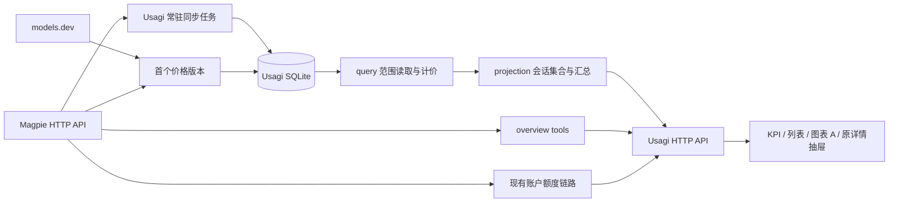

# 0. Usagi 会话页与 SQLite 数据层详细实施方案 v0.2

日期：2026-10-13。状态：供评审；尚未实施。设计依据：`docs/Usagi_会话页顶层设计与数据库方案_v0.1.md`。写作依据：用户指定的 `tech-spec-writing` 及其中文、排版规约。

本期通过 Magpie HTTP API 获取有效供应商目录，并随价格版本固化映射。Agent 图标不纳入本期；Tool 默认范围为「今天」。正文按设计共识及本轮确认的范围给出施工路径。

## 0.1 设计文档条目 → 方案章节

下表覆盖设计文档每组【已确认】条目。逐项计算、接口和施工动作只在指定章节定义。§11 决策是前文规则的重述，单独列出映射，防止遗漏。

| 设计文档条目 | 已确认内容 | 方案章节 |
| :--- | :--- | :--- |
| §0、§8 | 限定本期、重新核对行号、不使用快照数字、保留未提交改动 | §2.1、§3.2、§7 |
| §1.1 | 消耗链条愿景；数据源未提供的关系留空 | §3.1、§3.2、§4.1 |
| §1.2 | 两页共享 Token 和计价；本期先数据层、后会话页，请求页以后做 | §3.2、§4.1、§5 |
| §1.3 | 数据只来自 Magpie；包括日志重建会话 | §4.1、§6.2 |
| §1.4 | Usagi 自算费用；无 Tier；发生时价格版本；美元 | §4.1、§4.2、§6.3 |
| §1.5 | 每笔消耗只计一次；列表包含子 agent | §4.1、§6.4 |
| §3 | 收录全部会话元数据；不使用累计消耗 | §4.1、§6.4.1 |
| §3 | 同 ID Claude 合并；标题、项目用本地条目；Agent 显示 `claude` | §6.4.1 |
| §3 | 不同 ID 不合并；空壳会话入表；Codex 子会话保持独立行 | §6.4.1 |
| §3、§3.1 | 无账本行的 Token、缓存率、费用显示「—」；不加提示 | §4.3、§6.5.2 |
| §3 | 无会话 ID 的请求不进入会话页 KPI、列表、图表；不显示提示条 | §4.1、§6.4.2、§6.5.1 |
| §3.2 | `native_session` 优先；agent 族与 ID 联合身份；缺元数据和已消失会话保留 | §4.1、§6.4.1 |
| §3.3 | 本地日消耗；账本或 `last` 命中范围即收录 | §4.1、§6.4.2 |
| §3.3 | 筛选消耗；Claude 族筛选；完整 `cwd` 身份；模型筛选剔除无行会话 | §4.3、§6.4.2 |
| §3.4 | 拒绝行整行剔除；其他失败行参与统计 | §6.4.2 |
| §4.1 | 保持日期选项及 `7d / 30d` 标签；仅 Agent、模型、项目筛选；全部「终端」改为 Agent | §4.3、§6.5.1 |
| §4.1、§4.2 | 账户额度保持原链路、不受筛选影响 | §3.1、§6.2.4、§6.5.1 |
| §4.2 | 5 张 KPI；请求数代码保留但不显示 | §6.5.1 |
| §4.2 | Token 四项；缓存率含缓存写；费用自算；会话数等于列表长度 | §4.1、§6.4.4、§6.5.1 |
| §4.2 | 中位、P90 仅统计输入加输出大于 0 的会话；最近秩；底部文案 | §6.4.4、§6.5.1 |
| §4.2 | 不显示未归属提示；本期不设计未计价展示 | §3.2、§6.5.1 |
| §4.3 结构 | 6 列双行；右侧详情抽屉；全量取行、前端排序、每页 10 条 | §4.3、§6.5.2 |
| §4.3 排序 | 最后活动默认降序；项目和 3 个数值列可排序；不保留模型排序；空值始终末尾 | §6.5.2 |
| §4.3 字段 | 最后活动、标题、Agent 名称、项目；Agent 图标按本轮确认不做 | §6.4.1、§6.4.3 |
| §4.3 字段 | 主线程模型按输入加输出降序全部列出；无主线程行留空 | §6.4.3、§6.5.2 |
| §4.3 字段 | 合计 Token、缓存率、费用包含子 agent；Claude 计不同 `subagent`；Codex 显示未知 | §6.4.3、§6.5.2 |
| §4.3 组件 | beui Table 复用；独立表头高度；固定行高；只有会话列弹性宽度 | §4.3、§6.5.2 |
| §4.4 附注 | 抽屉保留现状，数据费用改为 Usagi 自算 | §6.4.5、§6.5.2 |
| §4.5 图表 A | 合并卡；模型 / 项目 pill Tabs；共享 Token / 费用状态；前 5 加其他；跟随页面 | §6.5.3 |
| §4.5 图表 B | 圆环及图例；调用次数、全部调用作分母；子 agent 调用包含在 Magpie 数据中 | §4.3、§6.5.4 |
| §4.5 图表 B | overview `tools`；独立今天 / 7 天 / 30 天；fixed / ignore；无费用切换 | §4.3、§6.5.4 |
| §4.5 图表 B | 前 8 加其他；本地日；默认今天；加载、失败、空态沿用现状 | §2.2、§6.5.4 |
| §5 | KPI 与列表 Token、费用之和相等；会话数等于条数 | §4.1、§7.1 的 T12 |
| §6.0–§6.1 | SQLite 前置交付；替换内存缓存；纯 Go 驱动；HTTP 同步 | §3.1、§5、§6.1、§6.2 |
| §6.3 | 仅同步结构化数据；不存正文；无预汇总；无 epoch / shadow / carry；冻结历史不备份 | §3.2、§4.2、§6.6、§8.3 |
| §6.4 | 本地日分页、60 天指纹分块、变化日事务替换、结束后 total 复核 | §6.2.1、§6.2.2 |
| §6.4 | 7 天冻结及结束后成功同步条件；首次起点取最早 series 日；冻结指纹差异只记库和日志 | §4.4、§6.2.1、§6.2.3 |
| §6.4 | 后端常驻；Magpie 不可用读库；首次同步骨架；全部 60 秒 | §4.3、§6.2.4、§6.4.6 |
| §6.4 | 会话全量 upsert；首次、最后出现时间；消失标记但保留 | §4.2、§6.2.4 |
| §6.5 | 全部本期表；`session_links` 空表；不存 `providerAccount`；不建覆盖价或模型映射表 | §4.2、§6.1 |
| §6.6 | 原始行、元数据入库；其余汇总自算；overview 仅供 Tool | §3.1、§6.3–§6.5 |
| §7.1、§7.2 | models.dev；本期无覆盖价、无倍率设置；1h 补齐；输入加输出门禁；served 回退 | §6.3 |
| §7.3 | 查询时现算；价格版本按请求时间；首版向前适用 | §4.1、§6.3.3 |
| §7.4 | model → served；供应商目录 → 厂商目录；别名；不使用 requested | §6.3.2 |
| §7.6 | 首次拉取一次；失败 60 秒重试；未计价按 0 并单独计数 | §6.3.1、§6.3.3 |
| §8 问题 1–12 | 每项对应施工动作 | §2.3 |
| §11 决策 1–6 | 合并、空值、提示、收录、Agent 族、模型筛选 | §6.4.1、§6.4.2、§6.5.1 |
| §11 决策 7–10 | 排序、模型、0 subagent、本地 Tool 日 | §6.4.3、§6.5.2、§6.5.4 |
| §11 决策 11–14 | 初始骨架、60 秒、冻结差异和不备份、不存账号 | §4.2、§6.2、§6.4.6、§8.3 |
| §11 决策 15–18 | 无倍率设置、计费门禁、served、完整查价顺序 | §6.3.2、§6.3.3 |
| §11 决策 19–22 | 查询现算、首版向前、首次拉价、保留基线 | §2.1、§6.3 |
| 本轮补充确认 | HTTP 获取目录映射并固化进价格版本；本轮确认 Agent 图标不做、Tool 默认今天 | §3.2、§4.2、§6.3.1、§6.5.2、§6.5.4 |

# 1. 文档目的

1. 让会话页使用可跨重启保存的 Magpie 结构化数据
2. 让历史费用按请求发生时的价格版本保持稳定
3. 让 KPI、会话列表和分布图共享同一统计对象
4. 让会话页按设计文档呈现筛选、5 张 KPI、6 列双行列表和 2 张图表
5. 将 SQLite 数据层拆成会话页之前可独立验收的交付物

# 2. 代码现状与问题

## 2.1 基线

| 项目 | 核对基线 |
| :--- | :--- |
| Usagi | `/Users/hogee/Desktop/Usagi`；分支 `magpie-companion-spec05`；提交 `ce29033eec84a22d7f8486548f8984a92d33db2f` 加现有未提交改动 |
| Magpie | `/Users/hogee/Desktop/参考项目/magpie`；提交 `8f2a314cf9779151b9caa5d60183e594239d0621` |
| Go / 前端 | `go.mod:3` 为 Go `1.27.1`；`frontend/package.json:6` 定义现有测试与构建命令 |
| 数据库 | 当前无 Usagi SQLite；本次目标 schema 为 `1` |
| 新依赖 | 锁定 `modernc.org/sqlite v1.60.1`；本机模块缓存的 `go.mod:3` 要求 Go `1.26.0`，低于仓库版本 |
| 本次操作 | 只改本文；所有后文「新增 / 修改 / 删除」均指未来施工 |

源码引用中，`Usagi:` 路径相对 Usagi 根目录，`Magpie:` 路径相对 Magpie 根目录。引用行号已重新读取。测试数据使用自建夹具，不固定设计文档中的本机统计数字。

## 2.2 可复用能力与事实依据

| 位置 | 已有能力或限制 | 施工用途 |
| :--- | :--- | :--- |
| `Usagi:internal/query/store.go:17`、`:251`、`:307` | 500 行分页、日拉取、最多 60 天指纹窗口 | 移入持久化同步；删除日缓存生命周期 |
| `Usagi:internal/magpie/client.go:134`、`:157` | 使用 `limit=1` 获取 series；JSON 规范化后 SHA-256；指纹含 cost 和拆分 | 原样复用指纹算法，日标签显式换算到注入的本地时区 |
| `Usagi:internal/query/usage.go:67`、`:193` | 拒绝判定、失败与重试、输出速度计算 | 保留算法，费用改用 Usagi 计价结果 |
| `Usagi:internal/projection/usage.go:79` | 四项 Token、缓存率、加总后派生指标 | 继续使用，不另写前端总数公式 |
| `Usagi:internal/query/project.go:9` | 已区分项目、无项目、未识别项目 | 保留完整路径身份和显示分类 |
| `Usagi:internal/api/range.go:99`、`:170`、`:233` | 本地 IANA 时区和日历范围，已处理日期边界 | 同步与查询共用同一个解析出的时区 |
| `Usagi:internal/app/discovery.go:18` | macOS 的 Usagi 目录在 Application Support | 数据库使用同目录下独立文件 |
| `Magpie:internal/usage/ledger.go:362`、`:406` | 配对日志行已隐藏；费用读取时计算 | Usagi 不再做第二轮请求去重 |
| `Magpie:internal/sessions/stats.go:95`、`:466` | overview 按本地日；分位数使用最近秩 | 核实 Tool「今天」；移植分位数，不使用 overview 的数值 |
| `Magpie:internal/gui/sessions.go:140` | overview 忽略 from / to；工具上限参数为 8 | Tool 只接受 `days=1/7/30` |
| `Magpie:internal/gui/providers.go:73`、`:496`、`:760`、`:882` | HTTP 返回有效 `providers[].catalog` | 保存价格版本的供应商目录快照 |
| `Magpie:internal/sessions/sessions.go:111` | `path` 为主文件路径；API 以 `~` 缩写路径 | 仅保存 `path != ""`，不读文件、不探测磁盘存在性 |
| `Magpie:internal/usage/usage.go:26`、`:112`、`:114` | 请求含 route_id、rid、response_id | 补齐 Usagi 当前未解码的字段；不用这些字段去重 |
| `Usagi:frontend/src/dashboard/scope.ts:4`、`:28` | fixed 范围、ignore 筛选已具备 | Tool 在独立依赖链中调用范围策略 |
| `Usagi:frontend/src/ui/beui/table/index.tsx:96`、`:157`、`:293` | 固定行高；表头共用 rowHeight | 增加 headerHeight，保持虚拟行估算 |
| `Usagi:scripts/ci/check_spec05_residue.sh:95`、`:107` | 当前禁止 modernc 和任何 SQLite | 删除这两处的 SQLite 禁令，保留旧扫描器残留禁令 |

`path` 是否存在在本文只指 HTTP 字段是否非空。Magpie 没有提供「文件当前是否可访问」布尔值。Usagi 不通过 `os.Stat` 补全它。

## 2.3 设计文档 §8 的逐项改动

| # | 重新核对的位置与问题 | 具体施工动作 |
| ---: | :--- | :--- |
| 1 | `MetricGrid.tsx:72`、`:84`、`:104` 缺缓存写 | §6.5.1 增加第 4 段、图例、焦点和 aria-label |
| 2 | `MetricGrid.tsx:125` 分母仅输入加缓存读 | §6.5.1 添加缓存写段，按同一分母显示 |
| 3 | `internal/query/usage.go:173`；投影直接累加行 cost | §6.3.3 计价；§6.4 用自算行替换核对 cost |
| 4 | `MetricGrid.tsx:161`、末尾 `MetricGrid`；`DashboardPage.tsx` 传参 | §6.5.1 恢复会话数卡；保留 `RequestMetric` 导出及测试 |
| 5 | `internal/query/sessions.go:30` 忽略无 ID；`internal/projection/summary.go:11` 另算 KPI | §6.4.2 限定会话消费集合；§6.4.4 从列表集合汇总 |
| 6 | `internal/query/sessions.go:25` 只在遍历账本时建组 | §6.4.2 添加 `last` 命中的元数据会话 |
| 7 | `internal/projection/sessions.go:133`、`:160` 仅主线程时间写入 | §6.4.3 独立计算整会话最后活动，不覆盖线程时间 |
| 8 | `internal/projection/sessions.go:61`；`sessionFormat.ts:17` 字母排序和 +N | §6.4.3 输入加输出降序；§6.5.2 全量模型文本 |
| 9 | `internal/projection/sessions.go:124`、`:274` 只处理 Claude | §6.4.3 分类 Codex 子 agent 用途；计数返回 null |
| 10 | `internal/projection/sessions.go:145` 返回 `ErrConflictingThreadParent` | §6.4.5 冲突父关系置空并记日志；会话按扁平归属加总 |
| 11 | `FilterControls.tsx:171`、`:178`；`SessionTable.tsx:77` | §6.5.1 改 Agent 文案和关联测试；独立 Agent 表列合入会话列 |
| 12 | `ChartSection.tsx:38`、`:39`；`DistributionDonutCard.tsx:25` | §6.5.3 单卡两套分组共享 metric；§6.5.4 增加 Tool 卡 |

# 3. 目标架构与范围边界

## 3.1 目标架构



SQLite 保存原始结构化数据和同步状态。`query` 读取库并在查询时计价。`projection` 生成页面契约。Tool 和额度不入库。请求无会话 ID 时仍入库，为同账本保留事实，但不进入会话页。

## 3.2 范围矩阵

| 维度 | 纳入范围 | 严格排除 |
| :--- | :--- | :--- |
| 数据 | HTTP 请求账本、会话元数据；SQLite schema、同步、冻结、价格版本 | 读取 Magpie 日志或缓存；正文；自行日志重建或配对去重 |
| 会话页 | 当前筛选、5 张 KPI、6 列列表、2 张图表、抽屉数据适配 | 请求页、供应商筛选、协作关系 UI、抽屉重设计、趋势图、Agent 图标 |
| 计价 | models.dev 首版、目录快照、基础价、查询时计算 | Tier、价格定时更新、立即同步按钮、覆盖价设置、倍率设置 |
| 表 | §4.2 全部表；空 `session_links` | `price_overrides`、`model_price_map`、预汇总表、Tool / 额度快照表 |
| 提示 | 原有加载、失败和空态 | 数据更新时间、冻结差异、未归入会话消耗、未计价模型展示设计 |
| 工程 | query、projection、api、app 装配、Magpie DTO、前端相关文件和定向 CI | Magpie 源码改动；复活旧 epoch / shadow build / carry 协议；无关重构 |

# 4. 架构契约与核心不变量

## 4.1 全局不变量

| 编号 | 契约与违规判定 |
| :--- | :--- |
| INV-01 | 消耗事实只来自 Magpie HTTP 请求行。请求归属于 `(agent_family, native_session 非空时取 native_session，否则 session)`。Claude 两个 Agent 同族，其余各自一族。重复计入同一请求即违规 |
| INV-02 | 会话页只统计有效、有会话 ID 的请求行。会话累计字段、无会话 ID 行和拒绝行参与会话页消耗即违规 |
| INV-03 | Token 总数为 input + cache_read + cache_write + output。缓存率为 cache_read / (input + cache_read + cache_write)，零分母为 null。重复累加 reasoning 或 cache_write_1h 即违规 |
| INV-04 | 同一范围、筛选下，KPI Token、费用等于列表合计，session_count 等于全部 items 长度。null 消耗行视作 0 加总。费用只在显示时舍入 |
| INV-05 | 当前范围数值仅来自窗口内经过筛选的请求。项目身份是完整 cwd；同名不同路径不能折叠 |
| INV-06 | 价格版本和版本内目录映射提交后不可改写。请求选发生时有效版本，早于首版使用首版。历史费用受后来价格或目录变更影响即违规 |
| INV-07 | frozen 日的 requests 与已提交同步基线不可再被 Magpie 差异覆盖。冻结差异仅为诊断信息 |
| INV-08 | providerAccount 不进入持久化表、原始响应存档或日志；会话正文不持久化；session_links 本期行数为 0 |

费用使用 `float64` / SQLite `REAL`，不将分币作为内部计价精度。合计以同一稳定行序累加，机器验收使用绝对误差不超过 `1e-9` 美元。Token 和会话数量要求精确相等。

## 4.2 最终数据模型

数据库文件：`~/Library/Application Support/Usagi/usagi.sqlite`。根目录权限 `0700`；数据库创建后权限 `0600`。`-wal` 和 `-shm` 是 SQLite 运行文件，不是备份。当前发布目标沿用 macOS，不增加其他平台数据路径分支。

schema 为 `1`。所有整数 Token、耗时和 ID 使用 `INTEGER`；Go 使用 `int64`。绝对时刻使用 Unix 纳秒，DTO 时刻仍使用 Unix 毫秒。日期使用本地 `YYYY-MM-DD`。下列 DDL 是唯一 schema 定义；本期无触发器。

```sql
CREATE TABLE app_meta (
  key TEXT PRIMARY KEY,
  value TEXT NOT NULL
);
INSERT INTO app_meta VALUES ('schema_version', '1');
INSERT INTO app_meta VALUES ('data_revision', '0');
INSERT INTO app_meta VALUES ('initial_sync_complete', '0');

CREATE TABLE sync_days (
  day TEXT PRIMARY KEY,
  fingerprint BLOB,
  row_count INTEGER NOT NULL DEFAULT 0,
  last_sync_ns INTEGER,
  frozen INTEGER NOT NULL DEFAULT 0,
  difference TEXT NOT NULL DEFAULT ''
);

CREATE TABLE requests (
  id INTEGER PRIMARY KEY AUTOINCREMENT,
  t_ns INTEGER NOT NULL,
  local_day TEXT NOT NULL,
  agent TEXT NOT NULL DEFAULT '',
  agent_name TEXT NOT NULL DEFAULT '',
  provider TEXT NOT NULL DEFAULT '',
  provider_name TEXT NOT NULL DEFAULT '',
  model TEXT NOT NULL DEFAULT '',
  requested TEXT NOT NULL DEFAULT '',
  served TEXT NOT NULL DEFAULT '',
  effort TEXT NOT NULL DEFAULT '',
  kind TEXT NOT NULL DEFAULT '',
  session TEXT NOT NULL DEFAULT '',
  native_session TEXT NOT NULL DEFAULT '',
  subagent TEXT NOT NULL DEFAULT '',
  parent_agent TEXT NOT NULL DEFAULT '',
  source TEXT NOT NULL DEFAULT '',
  route_id INTEGER NOT NULL DEFAULT 0,
  rid TEXT NOT NULL DEFAULT '',
  response_id TEXT NOT NULL DEFAULT '',
  status INTEGER NOT NULL DEFAULT 0,
  rejected INTEGER NOT NULL DEFAULT 0,
  error TEXT NOT NULL DEFAULT '',
  tries INTEGER NOT NULL DEFAULT 0,
  input INTEGER NOT NULL DEFAULT 0,
  output INTEGER NOT NULL DEFAULT 0,
  cache_read INTEGER NOT NULL DEFAULT 0,
  cache_write INTEGER NOT NULL DEFAULT 0,
  cache_write_1h INTEGER NOT NULL DEFAULT 0,
  reasoning INTEGER NOT NULL DEFAULT 0,
  ms INTEGER NOT NULL DEFAULT 0,
  ttft_ms INTEGER NOT NULL DEFAULT 0,
  first_text_ms INTEGER NOT NULL DEFAULT 0,
  flow_ms INTEGER NOT NULL DEFAULT 0,
  magpie_cost REAL NOT NULL DEFAULT 0,
  magpie_priced INTEGER NOT NULL DEFAULT 0
);
CREATE INDEX requests_day_time ON requests(local_day, t_ns);
CREATE INDEX requests_session ON requests(
  (CASE WHEN agent IN ('claude', 'claude-desktop') THEN 'claude' ELSE agent END),
  (CASE WHEN native_session <> '' THEN native_session ELSE session END),
  local_day
);

CREATE TABLE sessions (
  agent TEXT NOT NULL,
  id TEXT NOT NULL,
  cwd TEXT NOT NULL DEFAULT '',
  title TEXT NOT NULL DEFAULT '',
  start_ns INTEGER,
  last_ns INTEGER,
  gateway INTEGER NOT NULL DEFAULT 0,
  read_only INTEGER NOT NULL DEFAULT 0,
  has_path INTEGER NOT NULL DEFAULT 0,
  agent_name TEXT NOT NULL DEFAULT '',
  first_seen_ns INTEGER NOT NULL,
  last_seen_ns INTEGER NOT NULL,
  disappeared INTEGER NOT NULL DEFAULT 0,
  PRIMARY KEY(agent, id)
);

CREATE TABLE session_links (
  child_agent TEXT NOT NULL,
  child_id TEXT NOT NULL,
  parent_agent TEXT NOT NULL,
  parent_id TEXT NOT NULL,
  relation_type TEXT NOT NULL,
  source TEXT NOT NULL,
  PRIMARY KEY(child_agent, child_id, parent_agent, parent_id, relation_type, source)
);

CREATE TABLE price_versions (
  id INTEGER PRIMARY KEY AUTOINCREMENT,
  source TEXT NOT NULL,
  fetched_at_ns INTEGER NOT NULL,
  effective_at_ns INTEGER NOT NULL,
  provider_catalogs_json TEXT NOT NULL,
  maker_catalogs_json TEXT NOT NULL
);

CREATE TABLE prices (
  version_id INTEGER NOT NULL,
  catalog_id TEXT NOT NULL,
  model_key TEXT NOT NULL,
  canonical_model_id TEXT NOT NULL DEFAULT '',
  input REAL,
  output REAL,
  cache_read REAL,
  cache_write REAL,
  cache_write_1h REAL,
  PRIMARY KEY(version_id, catalog_id, model_key)
);
```

字段语义：

- `magpie_cost`、`magpie_priced` 只核对；请求自算费用不写入 requests
- requests 的可选字符串缺省为空，数字缺省为 0；不增加行级唯一约束
- `sync_days.fingerprint` 保存成功同步时的日指纹；`row_count` 保存完整日的原始行数，包含拒绝行
- `last_sync_ns` 只在完整日提交时更新；null 表示该日未完成同步
- `difference` 保存冻结日基线指纹与当前指纹，格式为 `基线十六进制指纹 -> 当前十六进制指纹`；无差异时为空串
- `start_ns`、`last_ns` 为 null 表示 Magpie 无有效时刻
- `has_path` 表示 HTTP path 非空；sessions 的累计 Token、cost、models 和 Via 不入库
- `agent_name` 保存现有 Agent 显示名称；前端沿用 agentDisplay 映射
- `session_links` 本期只建空表，不读写关系
- `provider_catalogs_json` 格式为 `{ "provider-id": ["catalog-a", "catalog-b"] }`，数组保留先后顺序；空目录仍保留供应商键
- `maker_catalogs_json` 是去除订阅零价目录后的有序厂商目录数组
- prices 只保存查价使用的 catalog_id、model_key、canonical_model_id 和 5 项单价；canonical_model_id 用于完整执行 Magpie 的 canonical_model_id 名称匹配，未提供时为空串；单价全部为 null 表示无价，明确的 0 价表示已知免费
- `app_meta` 只保存 schema_version、data_revision、initial_sync_complete；首次同步完成后将完成标记设为 1

写入方只有同步层。本期不设置外键、CHECK 或额外辅助索引。主键用于会话 upsert 和价格键查找。

## 4.3 公共接口与 DTO

### 4.3.1 后端入口与跨包类型

保留 `query.Service` 和 `projection.Service` 分层，不新增可插拔存储接口。

| 入口 | 最终契约 |
| :--- | :--- |
| `database.Open(path string) (*sql.DB, error)` | 打开、迁移和设置数据库；错误不回退内存 |
| `api.LocalTimezone() (string, *time.Location, error)` | 将现有 `systemTimezone` 直接改名导出，现有调用改用新名称；不留转发包装 |
| `query.NewService(db *sql.DB, client *magpie.Client, location *time.Location) *Service` | 直接客户端装配，测试沿用私有 upstream 假实现 |
| `query.NewRuntimeService(db *sql.DB, provider ClientProvider, location *time.Location) *Service` | 运行时装配；新客户端不清库 |
| `(*query.Service).Sync(ctx context.Context) (int64, error)` | 单次同步；返回数据库最新 data_revision，包括部分日已提交后发生错误的情况 |
| `(*query.Service).SessionDataset(ctx context.Context, q SessionQuery) (SessionDatasetResult, error)` | 返回候选元数据和已计价行；结果用既有 `SessionUsage`、`UsageRow` 表达，增加 `HasRows bool`、`Matched bool` 字段 |
| `magpie.Client.Providers(ctx context.Context) (ProviderCatalogsResponse, error)` | 仅解码 providers 的 id、catalog 及 fileError；不保存其余账号或设置字段 |
| `api.NewRevisionService(dataRevision int64) RevisionService` | 从库值初始化；现有创建调用同步修改 |
| `RevisionService.SetDataRevision(value int64) RevisionTuple` | 值变化就更新并发布 SSE；相同值不发布。替换旧 `BumpData` 及对应调用 |
| `pricing.Bootstrap(ctx context.Context, db *sql.DB, client *http.Client, providerCatalogs map[string][]string, now time.Time) (bool, error)` | 下载、验证并提交首版；bool 表示本次新增版本，不创建覆盖价或后续自动版本 |
| `pricing.Load(ctx context.Context, tx *sql.Tx) (*Catalog, error)` | 加载同一查询事务中的价格与目录；Catalog 是本次读取的只读快照 |
| `(*pricing.Catalog).PriceAt(t time.Time, provider, model, served string) (Price, bool)` | 按时间选版本并查基础价；bool 区分已知零价与无价 |
| `pricing.Price.Cost(input, output, cacheRead, cacheWrite, cacheWrite1h int64) float64` | 基础公式；1h 写入是缓存写的子集，不含 Tier |
| `projection.Service.ToolUsage(ctx context.Context, days int) (ToolUsageView, error)` | 返回 overview 的 tools；只接受 1、7、30，不接收页面筛选 |

`magpie.ProviderCatalogsResponse` 导出 `Providers []ProviderCatalog`、`FileError string`；`ProviderCatalog` 只含 `ID string`、`Catalog string`。`projection.ToolUsageView` 导出 `Days int`、`Calls int64`、`Top []ToolUsageItem`；`ToolUsageItem` 只含 `Name string`、`Calls int64`。

`pricing.Price` 只导出 `Input`、`Output`、`CacheRead`、`CacheWrite`、`CacheWrite1h` 这 5 个 `float64` 字段；`Catalog` 的索引和版本字段均私有。`SessionDatasetResult` 字段固定为 `Sessions []SessionUsage`、`Rows []UsageRow`。HTTP 响应保留现有 data_revision 字段，用于 SSE 刷新。`SessionListView` 增加 `Summary SummaryView`。`SummaryView` 增加 `SessionMedian *int64`、`SessionP90 *int64`。

`SessionListItemView` 增加 `HasUsageRows bool`、`LastActivity time.Time`。`SubagentCount` 改为 `*int64`。`SessionUsage` 保留已有 Agent、ID、Title、Cwd、Project、Start、Last、FirstUsage、LastUsage、ModelEffort 和 Totals；新增 HasRows、Matched。`SessionThreadView` 的线程自身时间和 `UsageView` 仍保持原语义，避免抽屉把子 agent 消耗写回主线程。

### 4.3.2 HTTP 端点清单

| 端点 | 保留 / 改动 | 前端影响 |
| :--- | :--- | :--- |
| `GET /api/usage/summary` | 保留；SQLite 会话集合汇总；增加分位数 | 既有接口调用仍可取汇总；Dashboard 共享控制器改从 sessions 响应获取 |
| `GET /api/usage/sessions` | 保留；增加 summary、has_usage_rows、last_activity_ms；计数可空 | 一次拿全表；KPI 和分页前列表原子更新 |
| `GET /api/usage/model-distribution` | 保留；只对会话消费集合分组，自算费用 | 图表 A 模型标签 |
| `GET /api/usage/projects` | 保留；相同消费集合按完整项目身份分组 | 图表 A 项目标签 |
| `GET /api/usage/filter-options` | 保留；加上无行元数据的 Agent 与项目，Agent 族去重 | 可筛选无行会话；无行会话不产生模型选项 |
| `GET /api/usage/session-detail` | 保留；SQLite 数据、自算费用、父关系冲突不报全局失败 | 抽屉布局、键、请求格式保持；支持无行会话 |
| `GET /api/usage/tools` | 新增；仅允许单个 days 参数，值为 1、7、30 | Tool 独立加载和范围切换 |
| `GET /api/quota`、`POST /api/quota/refresh` | 保留现状 | 不受页面范围和筛选影响 |
| revision / events / status / service / health | 保留路径；数据库 revision 持久化 | SSE 继续驱动重读；不新增刷新状态 UI |
| `GET /api/v1/usage/summary` | 保留公开 DTO；仍限定 Codex；底层费用和数据改读库 | 托盘与公开消费者不新增字段；断网有库时也能读取 |
| 其余 `/api/v1/*` | 保留 | 不改变能力列表，不新增公共请求页端点 |

现有范围和多选参数保持：`range`、custom 的 `from/to`、重复 `agent`、重复 `model_at=provider/model`、重复 `project_path`、`include_projectless`、`include_unknown_project`。模型选择保持现有 provider+model 键；会话页不新增供应商筛选。`claude-desktop` 输入规范化为 `claude` 族。detail 的 agent 参数是目标键，不额外限制消费 Agent。

新增 JSON 字段如下。保留原 usageDTO 全部字段，不删除当前工作区新增的请求数、失败、重试、速度字段。

```typescript
// SummaryResponse 增加以下字段；sessions.summary 使用相同结构。
session_median: number | null;
session_p90: number | null;

// SessionsResponse 增加：
summary: SummaryResponse;

// SessionListItemDto 增加或修改：
has_usage_rows: boolean;
last_activity_ms: number | null;
subagent_count: number | null;

// ToolUsageResponse：
{ days: 1 | 7 | 30; calls: number;
  top: Array<{ name: string; calls: number }>; }
```

数组无内容时返回 `[]`。无行会话的 usageDTO 仍为零值；前端使用 `has_usage_rows=false` 显示「—」，避免零值与未知值混淆。缓存率本身为 null 时也显示「—」。

首次同步未完成时，库读端点返回 HTTP `503` 和 `DATA_LOADING`。前端将它映射为加载与骨架，不显示错误提示。其他失败沿用现有错误处理，不新增错误码。

### 4.3.3 时间与一致性边界

`requests.local_day` 使用注入的本地时区。范围两端均包含，用日期比较读取。混合 `Z`、时区偏移的 `t` 解析成同一绝对时刻。不把 `+08:00` 写死。Tool「今天」由 Magpie 本地日定义，当前本机与 Usagi 采用同一系统时区。

KPI 使用 sessions.summary，与全部列表行一起返回。图表继续按现有 SSE 刷新，不增加跨端点 revision 校验或重读机制。app_meta.data_revision 用于通知数据变化，不要求绑定查询事务。

## 4.4 同步业务状态

| 当前状态 | 事件 | 目标状态 | 条件与拒绝行为 |
| :--- | :--- | :--- | :--- |
| 未同步日 | 完整日拉取提交 | 可变日 | 分页完成且结束后 total 复核一致；失败仍未同步 |
| 可变日 | 变化日完整提交 | 可变日 | 旧日与新日互斥可见；失败保留旧日 |
| 可变日 | 冻结条件成立 | 冻结日 | day < 今天−7 日，且该日结束后完整成功同步过；其他日期不冻结 |
| 冻结日 | 上游差异 | 冻结日 | 只写 difference 和日志，不覆盖 requests |
| 首次同步中 | 起点到今天各日完整同步过一次 | 可读取 | 从最早 series 日到今天每个日期均已完整同步；价格失败不阻止完成 |
| 已可读取 | Magpie 不可用 | 可读取 | 数据端点继续读库；Tool、额度沿用各自失败行为 |

本期没有解冻、清库、价格版本删除或重算历史的产品入口。

# 5. 施工路线与任务分工

## 5.1 阶段、文件与门禁

所有阶段串行施工。每个阶段自行编写定向测试，不拆分「写代码」与「测试」任务。未通过门禁时停止下一阶段。

| Spec | 范围与主要改动文件 | 前置 | 第 6 章步骤 | 独立完成标准与门禁 |
| :--- | :--- | :--- | :--- | :--- |
| S01 SQLite 基础 | 新增 `internal/database/db.go`、`schema.sql`、`db_test.go`；修改 `go.mod/go.sum`、`internal/app/app.go`、`internal/api/range.go`、CI 残留门禁 | 当前基线 | §6.1 | 能新建和重开 schema 1；迁移失败无部分表；纯 Go 编译；T01 |
| S02 结构化同步 | 新增 `internal/query/sync.go`、`sync_test.go`；修改 `magpie` 请求 / 会话 DTO、`runtime_upstream.go`；移走 store 的日拉取算法；修改 watchers / revision 装配 | S01 | §6.2 | 首次按日同步、整天替换、冻结、元数据保留；重启不重拉已完成历史；T03、T05–T07 |
| S03 价格版本 | 新增 `internal/pricing/catalog.go`、`lookup.go`、`pricing_test.go`、fixtures；新增 `internal/magpie/types_providers.go`；修改 `client.go`、同步入口 | S02 | §6.3 | HTTP 取目录和 models.dev；首版事务保存；版本计价测试通过；T08–T10。S01–S03 构成前置数据层交付 |
| S04 会话投影与接口 | 修改 `query/{service,types,usage,sessions,filter_options}.go`、`projection/{types,service,sessions,summary,distributions,filters}.go`、`api/{server,routes_internal,dto_internal,public_v1,errors}.go`；新增定向测试 | S03 | §6.4 | 新接口返回一致集合；离线读库；抽屉能读；KPI 等于列表；T11–T15 |
| S05 会话页 UI | 修改 `DashboardPage.tsx`、`MetricGrid.tsx`、`FilterControls.tsx`、控制器、托盘受影响的 fixtures 与测试、`session/*`、`charts/*`、`scope.ts`、`data/{types,usagiClient}.ts`、Table 3 个文件及关联测试；新增 Tool 卡与控制器 | S04 | §6.5 | 5 卡、6 列、2 图；Tool 不跟随页面；全部定向前端测试通过；T16–T19 |
| S06 清理和整体交付 | 删除剩余 `store.go/store_test.go` 缓存残留；修改 `.github/workflows/ci.yml`、残留门禁、现有浏览器验收与 smoke；重建 `internal/webui/dist` | S05 | §6.6 | 全仓最终检查一次；无旧缓存读取路径；生产构建与人工验收通过 |

S02 的同步入口可先独立验收持久化；在 S04 切换前，旧查询读链路仅是尚未改完的阶段代码，不作为最终运行模式。S04 将当前查询全量改读库。任何阶段均不新增运行时「SQLite 失败则内存读取」分支。S01–S03 验收只针对数据层，不把旧会话页的费用口径当成新数据层验收结果。

## 5.2 交付门禁的顺序

1. 完成 S01 的数据库基础验收
2. 完成 S02 的同步与冻结验收
3. 完成 S03 的价格与历史版本验收，签收前置数据层
4. 完成 S04 的会话集合、接口和抽屉验收
5. 完成 S05 的页面定向测试及人工界面验收
6. 完成 S06 的残留、构建和整体冒烟

# 6. 详细实施步骤

## 6.1 接入 SQLite 与迁移（S01）

目标文件：`[新增] internal/database/{db.go,schema.sql,db_test.go}`；`[修改] go.mod/go.sum`、`internal/app/app.go`、`internal/api/range.go` 及对应测试、`scripts/ci/check_spec05_residue.sh`。遵循 §4.2 和 INV-08。

1. 加入并锁定 `modernc.org/sqlite v1.60.1`，使用 `database/sql`
2. 将 §4.2 DDL 保存为嵌入的 `schema.sql`
3. 使用 URL 编码构造文件 DSN，不拼接未经编码的路径
4. 给每条连接设置 `_pragma=busy_timeout(5000)`、`synchronous(FULL)`
5. 设置 `SetMaxOpenConns(4)` 和 `SetMaxIdleConns(4)`；不设连接定时失效
6. 在启动时设置并核实 `journal_mode=WAL`
7. 在事务中创建 schema 和写入 schema_version；仅空库执行首版迁移
8. 如果迁移失败，返回错误并停止启动
9. 将现有 `systemTimezone` 直接改名为 `LocalTimezone`，更新调用和测试
10. 在 app 中取得时区并打开数据库；等待服务结束后关闭数据库。S02 修改 query 构造器时再注入数据库和时区
11. 删除残留脚本中对 modernc / SQLite 的笼统禁令，保留旧解析器和旧存储协议禁令

迁移使用单事务、固定编号的内嵌 SQL，不新增迁移框架。`app_meta.schema_version` 是唯一迁移版本来源。同步 goroutine 只有 1 个写入协调者；网络拉取不占数据库事务。WAL 允许读事务读取已提交快照。

本机驱动 `_pragma` 行为依据：`/Users/hogee/go/pkg/mod/modernc.org/sqlite@v1.60.1/sqlite.go:443`。不引入 cgo 或其他 SQLite 驱动。阶段验证先运行 `CGO_ENABLED=0 go test ./internal/database`，再运行 `go test ./internal/database -run 'Schema|Migration'`。连接权限和 pragma 不单独编写测试。

## 6.2 将日缓存改为持久化同步（S02）

### 6.2.1 发现日期并比较指纹

目标文件：`[新增] internal/query/sync.go`；`[修改] internal/query/{service,runtime_upstream}.go`、`internal/magpie/{client,types_usage,types_sessions}.go`、`internal/api/watchers.go`。遵循 INV-01、INV-07、INV-08。

1. 给 UsageRequest 加 RouteID、RID、ResponseID，对应原 JSON 字段
2. 给 magpie.Session 加 Path；只转换为 has_path，保留现有 name 解码
3. 读取 `/api/usage?period=all`，起点取最早 series 时间的本地日
4. 枚举起点到今天的日期；没有 series 时将今天作为空账本的同步日
5. 按不超过 60 个日历日分块获取 UsageDayDigests
6. 选择未完成同步日，以及指纹变化的未冻结日
7. 使用现有 usageFingerprint 比较前后两次全局汇总
8. 全局汇总指纹变化时，把今天和昨天的未冻结日加入完整拉取目标
9. 对早于冻结界限但 last_sync_ns 不晚于日结束的日期，完整拉取一次
10. 对冻结日只使用分块得到的指纹，执行 §6.2.3

全局指纹变化的触发条件沿用 `Usagi:internal/api/watchers.go:150` 的 summaryChanged，以及 `Usagi:internal/query/store.go:157` 的 forceRecent。首次调用先建立全局指纹基线；初次日拉取由未同步日条件触发。今天、昨天不按每个周期无条件重拉。

复用现有 JSON 规范化 SHA-256 和 60 天分块。日标签按 `point.Time.In(location).Format(time.DateOnly)` 获取。指纹保留 Magpie cost；费用计算不读取该值。`all` 用来确定起点并计算全局汇总指纹，不按 all 做请求分页。

首次同步期间，每次从 all 最早 series 日枚举到今天，利用 sync_days.last_sync_ns 继续未完成日期。每个日期均完整提交过一次后，设置 initial_sync_complete。只保留这个完成标记，不持久化发现范围。已完成后按同一日指纹流程同步可变日，冻结历史保留。

### 6.2.2 拉全一天并原子替换

目标文件：`[新增] internal/query/sync.go`、`sync_test.go`；迁移 `store.go:251` 的分页路径。遵循 INV-07。

1. 创建 `period=D..D`、`limit=500`、`offset=0` 查询，不附加页面筛选
2. 顺序分页，累积行并记录各页 total
3. 分页结束后请求 `offset=0`、`limit=1`，复核 total
4. 如果分页未拉全或任一次 total 变化，放弃本日，下个周期再拉
5. 在一个写事务中删除该日旧 requests 并插入全部新行
6. 更新该日 fingerprint、row_count、last_sync_ns，并清空 difference
7. 增加 app_meta.data_revision 并提交事务

fingerprint 使用本周期分块取得的日指纹。日请求失败或写事务失败时保留旧日。0 行日也提交完整同步状态。

沿用最多 4 个日期并行拉取和 2 分钟单日超时，写事务串行。providerAccount 不传给 INSERT。原始拒绝行入库，查询时排除。Magpie 没有分页快照；同 total 的行变化是上游限制，不增加行级去重分支。

### 6.2.3 冻结与差异记录

目标文件：`[新增] internal/query/sync.go`、`sync_test.go`。遵循 INV-07 和 §4.4。

1. 用本地日历日期计算 cutoff=今天−7 日
2. 检查 day<cutoff 且 last_sync_ns 晚于该日结束
3. 条件满足时将 frozen 设为 1
4. 对不满足成功同步条件的旧日，完整拉取后再判断冻结
5. 用分块已取得的指纹与冻结日基线比较
6. 有变化时写 difference 并记录日与指纹差异日志

首次同步的旧日完整提交后即可满足冻结条件。今天−7 日本身不冻结。冻结后的指纹变化不覆盖 requests、fingerprint、row_count 或 last_sync_ns，不发页面提示。不为冻结日追加单日请求。difference 仅保存最近一次发现的指纹差异，不建设观察历史。

### 6.2.4 会话、调度与离线

目标文件：`[修改] internal/query/{service,runtime_upstream}.go`、`internal/api/{watchers,revision,server}.go`、`internal/app/app.go` 及对应测试。遵循 §4.3、§4.4。

1. 修改 query 构造器，注入 S01 打开的数据库和时区
2. 在单次 Sync 内全量获取 `/api/sessions?limit=0`
3. 在事务中将已有会话标记为 disappeared，再按 `(agent,id)` upsert 返回集合
4. 保留已存在的 first_seen_ns；更新 last_seen_ns 和 disappeared=0
5. 保留未返回条目的全部最后元数据，仅将 disappeared 设为 1
6. 元数据内容或消失状态变化时增加 data_revision；纯 last_seen 更新不增加
7. 调用日同步和尚未完成的首版价格拉取
8. 当起点到今天每个日期均完整同步过一次时，设置 initial_sync_complete=1 并增加 revision
9. 在 watchers 中立即运行一次 Sync；随后每 60 秒运行；上一次未结束时不并发叠加
10. 在 Magpie 从不可用恢复 ready 时唤醒一次 Sync
11. 读取 Sync 返回的库 revision，用 SetDataRevision 发布最新值，即使部分日期提交后发生错误
12. 将额度自动轮询改为 60 秒，包括原 reading 状态的 1 秒加速轮询；保留用户手动刷新
13. 停止 Runtime generation 变化时清空数据；只更换 HTTP 客户端，不删除持久化数据

日期计算使用注入的 location。重启读取完成标记、已冻结日和价格版本，不无条件重新拉取所有历史。会话拉取失败时不标记整批消失。

Magpie 不可用时，同步失败只写后端日志。库读端点不依赖 Runtime ready。已有完整库继续显示；首次空库保持骨架并等待成功同步。Tool 和额度沿用原卡片失败行为，不假造数据。

额度和 Tool 都是实时链路，不存历史。Tool 由独立前端控制器按 60 秒轮询当前 days，范围切换立即请求。价格首次失败也在 60 秒同步周期重试，不增加专门更新配置。


## 6.3 保存价格版本并移植基础查价（S03）

### 6.3.1 首版价格与目录快照

目标文件：`[新增] internal/pricing/catalog.go`、`internal/magpie/types_providers.go`；`[修改] internal/magpie/client.go`、`internal/query/{runtime_upstream,sync}.go`。遵循 INV-06、INV-08。

1. 如果库已存在价格版本，结束首版拉取，不再下载或更新目录
2. 下载 `https://models.dev/api.json`，设置 30 秒 HTTP 超时
3. 调用 Magpie `GET /api/providers`，不传 wait
4. 只解码 providers 的 id、catalog 和 fileError，丢弃价格、倍率、账号和密钥字段
5. 如果任一请求失败、fileError 非空或价格目录无有效结构，不生成版本
6. 按 `Provider.Catalogs` 的小写、逗号 / 空格拆分、去空、保序去重规则整理目录
7. 移植 `makerCatalogs` 使用的预设厂商目录顺序，排除 Hosts 和 membershipCatalogs
8. 保存 models.dev 全部模型的目录键、模型键、canonical_model_id 和基础 5 项单价；cost 缺失时将 5 项单价保存为 null；忽略 tiers 及其他模型资料
9. 按 Magpie `OneHourFor` 的条件补齐 Claude 1h 价，其余以 5 分钟缓存写价为 1h 有效价
10. 在一个事务中插入 price_versions 和 prices，写入来源、获取时间、生效时间和 2 份目录 JSON
11. 增加 data_revision 后提交

单价单位为美元 / 百万 Token。models.dev 的 cost 缺失保留为无价；cost 对象中的缺省标量按 Magpie 的零值语义解析。Claude 1h 补齐条件为模型名含 claude、cache_write>0、cache_write_1h 未提供正价，补齐为 `2×input`。不能对 cache_write=0 的 Claude 条目无条件补价。来源保存 models.dev URL。

有效厂商目录的静态顺序以 `Magpie:internal/provider/models.go:1004` 和 `internal/provider/presets.go` 为准。本期把顺序作为价格版本的 maker_catalogs_json 固化。供应商目录则来自 HTTP；不按供应商 ID 猜目录。

### 6.3.2 按本机账本组合移植查价

目标文件：`[新增] internal/pricing/lookup.go`、`pricing_test.go`、`testdata/catalog.json`、`testdata/ledger_price_cases.json`。遵循 INV-06。S03 在移植前从 S02 同步结果列出实际组合，覆盖清单随本阶段验收交付。

```sql
SELECT DISTINCT provider, model, served
FROM requests
ORDER BY provider, model, served;
```

覆盖清单只列上述 3 个字段，不包含账号、会话 ID 或正文。清单的组合数量是验收快照，不写入逻辑或测试断言。每个组合按本次获取的 models.dev 和 HTTP 供应商目录逐项核对。

| 清单字段 | 内容 |
| :--- | :--- |
| provider / model / served | 本机账本原值，包括空值 |
| 查询模型 | 实际用 model 或 served，或无价 |
| 目录 / 模型键 | models.dev 的实际命中键；无价时为空 |
| 5 项基础价 | 命中单价；无价时为空 |
| 结论 | 已命中，或确认无价及查过的目录 |

1. 列出本机全部组合，按下表的查价顺序确认每项命中或确实无价
2. 对照 Magpie 源码记录实际命中键和所经过的名称匹配分支
3. 完整移植 pricedNames、PricedBy 及其依赖的名称匹配函数，不按本机组合裁剪分支；以后账本出现新模型名时，查价结果须与 Magpie 一致
4. 把实际组合及期望价格加入 ledger_price_cases.json
5. 用同一目录夹具验证每个组合；无价也是明确的期望结果

| 层级 | 唯一路径 | Magpie 依据 |
| :--- | :--- | :--- |
| 请求模型 | 先查 model；无价且 served 非空并与 model 不同时再查 served；同一 provider；不使用 requested | `internal/usage/ledger.go:445` |
| 已知 provider | 对名称候选先查有效供应商目录，再查厂商目录 | `internal/provider/models.go:1033`、`:1040`、`:1043` |
| 未知 provider | 直接查厂商目录 | `internal/provider/models.go:1088`、`:1144` |
| 名称匹配 | 完整移植 pricedNames 和 PricedBy（含 catalog.go 中依赖的名称匹配函数），保留源码先后顺序 | `internal/provider/models.go:1232`；`internal/catalog/catalog.go:602` |
| 单价 | 只用基础 5 项价，跳过自定义价和 PriceRate；倍率为 1 | `internal/provider/models.go:1131` |

不按本机 Magpie cost 反推出单价。测试使用本机实际出现的名称；只有设计要求的 served 回退、计费门禁和版本边界使用最小 Token / 时间夹具。账本未出现的 Grok、Bedrock、Kimi 别名等随完整移植一并实现，但不单独写测试。本机组合覆盖清单作为验收依据。

价格表保存版本内各目录的全部模型键；有价模型保存 5 项基础价（不限于本机账本已出现的模型），cost 缺失模型的 5 项价格均为 null。另保存完整 `PricedBy` canonical_model_id 匹配所必需的 `canonical_model_id`，不保留原模型资料的其他字段。查不到的模型保持未计价，不建立 model_price_map，不猜测别名。供应商映射取价格版本中的 HTTP 快照，不读取当前 Magpie 自定义价格或磁盘缓存。

### 6.3.3 按请求时间计价

目标文件：`[新增] internal/pricing/lookup.go`；`[修改] internal/query/usage.go`、`types.go`。遵循 INV-03、INV-06。

1. 将所有 price_versions 按 effective_at_ns 升序加载
2. 对请求 t 选择 effective_at_ns≤t 的最后一版；不存在时选择首版
3. 如果完全没有版本，将该行标记为未计价，费用置 0
4. 如果 input+output≤0，费用置 0，不进入计价和未计价计数
5. 对可计费行执行 §6.3.2 查价；无价时费用置 0，Unpriced 加 1
6. 使用 cache_write_1h 子集计算 1h 费用，其余缓存写按 5 分钟价
7. 用基础 5 项单价计算费用；不调用 Tier 的 At
8. 把费用和 Priced 写入查询行，仅在内存结果中保存

```text
cost = (input × input_price + output × output_price
      + cache_read × cache_read_price
      + (cache_write − cache_write_1h) × cache_write_price
      + cache_write_1h × cache_write_1h_price) / 1e6
```

免费但有明确价格的行是 Priced=true、cost=0，不算未计价。未计价计数只针对 input+output>0 且查价失败的行。reasoning 和 Magpie cost 不进入公式。查询批次按 `(version,provider,model,served)` 缓存查价结果，结束后丢弃；不建模型映射表。

本期只自动创建首版。版本选择函数仍按 §4.2 支持多个已保存版本，使用测试夹具验证第二版，不增加创建第二版的用户入口。

## 6.4 生成会话集合、汇总和后端接口（S04）

### 6.4.1 从库构建会话身份与元数据

目标文件：`[修改] internal/query/{service,sessions,types}.go`。遵循 INV-01、INV-05。

1. 读取当前范围请求、会话元数据和价格
2. 用 agent 族加 ID 建会话元数据索引；只合并 claude / claude-desktop 的同 ID 条目
3. 对合并 Claude 条目，用 claude 本地条目的 title 和 cwd；不要因 title 为空改取网关标题
4. 对合并条目的 last 取较晚有效值，start 取较早有效值
5. 对只有 claude-desktop 的条目，保留它的元数据并将显示 Agent 规范为 claude
6. 请求会话 ID 严格取非空 native_session，否则 session；不因匹配失败改投另一 ID
7. 如果请求键没有元数据，创建 Matched=false 的虚拟元数据条目
8. 保留 disappeared 条目的最后元数据；范围收录仍按 §6.4.2 判定

无元数据的标题为空，页面显示「未命名会话」，项目为 unknown，显示「未识别项目」。元数据 cwd 为空时项目为 projectless，显示「无项目」。网关空壳标题沿用 Magpie 返回的会话 ID。不同 ID 不合并，也不把 Codex 无行会话猜成某个父会话。

Claude 的非空 subagent 行只进入其父会话消耗，不为 subagent 人工创建新的列表会话。Magpie 本身提供的独立子进程元数据仍按收录规则保留，这是元数据会话，不是 Usagi 人工拆出的线程。

### 6.4.2 应用范围、筛选和收录规则

目标文件：`[修改] internal/query/{usage,sessions,filter_options}.go`。遵循 INV-02、INV-05。

1. 按本地日范围读 requests，剔除 rejected 或 provider 为空且 status≥400 的行
2. 保留其他失败行；它们参与 Token、会话存在性和正常计费门禁
3. 去掉会话页消费集合中会话 ID 为空的行
4. 根据规范化 agent 族应用 Agent 多选
5. 根据现有 provider+ModelName(model) 键应用模型多选；空模型使用现有「未知模型」键，多个模型取并集
6. 以合并后的会话元数据 cwd 应用项目筛选；不同筛选维度取交集
7. 将剩余行归入会话，标记 HasRows=true
8. 如果没有模型筛选，补入 last 位于范围内且满足 Agent、项目筛选的元数据会话
9. 如果某元数据会话在范围内没有匹配行，标记 HasRows=false
10. 如果存在模型筛选，不补入无匹配行的元数据会话

如果范围内请求被筛选掉且没有模型筛选，元数据 `last` 命中仍可以产生无行会话，Agent 和项目继续按元数据判定。无行会话不产生模型选项。FilterOptions 使用未加筛选的同范围会话集合，Agent 按族去重；模型保留现有 provider 名称分组机制；项目按 kind+完整 path 去重。

### 6.4.3 计算列表字段与主线程

目标文件：`[修改] internal/projection/sessions.go`、`types.go`。遵循 INV-03、INV-04。

| 字段 | 计算动作 |
| :--- | :--- |
| LastActivity | 有行时取当前范围、筛选后全部行 t 最大值，包括子 agent；无行时取合并元数据 last |
| Title / Agent / Project | 使用 §6.4.1 合并结果；显示名沿用现有映射，Claude 族输出 claude |
| SelfUsage | Claude 族取 subagent 空行；Codex 取 kind 不为 collab_spawn、thread_spawn、agent_job 的行；其他 Agent 取本会话行 |
| SubagentUsage | Claude 非空 subagent 行；Codex 的 3 类子 agent 用途行；其他 Agent 无可用关系时不猜测 |
| InclusiveUsage | 同会话全部已筛选行直接加总 1 次；不从子线程递归重复求和 |
| 主模型 | 主线程按 `(model,effort)` 汇总 input+output，降序；并列按 model、effort 字典序；保留主线程用过的所有组合，包括 0 Token 的请求组合 |
| SubagentCount | Claude 族取筛选后不同非空 subagent 个数；有行或无行均可确定集合大小为 0；Codex 固定 null；其他 Agent 维持当前无子线程的 0 |
| Token / CacheHitRate / Cost | 使用 InclusiveUsage 及现有 deriveUsage；无行标记由 HasUsageRows 表达，不改成「确知零消耗」 |

`thread.model_effort` 使用主线程组合，按上述次序输出，不使用 sessions.models。范围内只有子 agent 行时仍有 InclusiveUsage，但主模型数组为空。列表最后活动通过新字段返回；线程 FirstUsage / LastUsage 保持该线程自己的时间。

### 6.4.4 从相同集合产生 KPI 和图表 A

目标文件：`[修改] internal/projection/{summary,sessions,distributions,usage}.go`。遵循 INV-03、INV-04。

1. 从完成的会话列表集合累加 InclusiveUsage，生成 SummaryView
2. 将 RootSessionCount 设为 Items 长度，不统计线程数量
3. 收集每个会话的 inclusive input+output，仅保留大于 0 的值
4. 对收集值升序排列，取 `sorted[max(0,ceil(p*n)-1)]`，p 为 0.5 和 0.9
5. 如果集合为空，返回两个 null；不调用 overview
6. 按同一消费集合的全部行分组模型和项目，生成 2 个分布响应
7. 从相同消费集合计算 Usage.Unpriced 和未计价会话内部计数，不新增提示 UI

Summary 入口与 Sessions 入口调用同一集合算法；不要再次走原来能包含无会话 ID 的 Usage 全局路径。Dashboard 使用 sessions 内的 summary，避免独立请求到不同提交时刻。图表 A 按全部会话消费分组，包括子 agent 的模型；主模型列则仍只显示主线程模型。

### 6.4.5 保留详情抽屉并隔离父关系冲突

目标文件：`[修改] internal/projection/sessions.go`、`types.go` 和关联测试。遵循 INV-01、INV-04。

1. 让 detail 从库读取结果得到会话和行，不依赖 Magpie 单会话 lookup
2. 保留 ThreadKey、self / subagent / inclusive 和 Children 的接口结构
3. 对 Claude 子线程按不同 subagent 创建原详情线程，不创建列表子行
4. 收集每个子线程所有非空 parent_agent 值；恰有 1 个时保留父关系
5. 如果非空父值冲突，将该线程 ParentThreadID 留空并写后端日志
6. 删除 ErrConflictingThreadParent 的查询失败分支、错误映射和无用符号
7. 根会话消耗使用扁平归属，不根据 parent_agent 递归重复加总
8. 保留已有 Codex compaction 统计和解码速度算法，不改抽屉布局

无行会话仍可打开详情，线程数值按现有空态显示。父关系冲突不影响会话整体读取和消费合计。

### 6.4.6 接入 API、修订事件与首次加载

目标文件：`[修改] internal/api/{server,routes_internal,dto_internal,errors,public_v1,revision}.go`；`internal/query/runtime_upstream.go`。遵循 §4.3。

1. 将库读取路由的 requireRuntimeReady 改为检查 initial_sync_complete
2. 根据 §4.3 返回新增字段和 DATA_LOADING；其余错误处理保持现状
3. 新增 ToolUsage 投影和 `/api/usage/tools` 路由，只读取 tools.calls/top
4. 保留额度与 Tool 的上游可用性门禁，不将库可用视作 Magpie 可用
5. 在 public v1 summary 中保留 DTO 和 Codex 限定，revision 沿用现有获取方式
6. 将 SSE revision 初值设为 app_meta.data_revision；Sync 完成后发布库值
7. 更新 API fakes、DTO fixtures 和受影响测试，不修改未涉及的公开字段

首次同步过程中已提交的部分历史留在库中，但尚不对会话页显示成完整集合。从最早 series 日到今天的全部日期完成后解除加载门禁。已有完整库后新日同步失败不回到骨架。价格未取得时数据仍可读取，费用和未计价遵循 §6.3.3。

## 6.5 修改会话页界面（S05）

### 6.5.1 KPI、筛选与控制器

目标文件：`[修改] frontend/src/dashboard/{DashboardPage,MetricGrid,FilterControls}.tsx`、`useDashboardController.ts`、`session/{useSessionTableController,sessionTypes}.ts`、`frontend/src/data/{types,usagiClient}.ts` 和关联测试；修改 `frontend/src/tray/TrayPanelPage.test.tsx` 的 HTTP 假实现及 `TrayPanelMeasurementPage.tsx` 的静态 DTO。遵循 INV-03、INV-04、§4.3。

1. 在 usagiClient 中严格解析新增 nullable 字段、summary 和 DATA_LOADING
2. 让 useDashboardController 改为请求 sessions，将响应的全部 items 与 summary 保存为同一完整快照
3. 让 MetricGrid 的 usage、session_count、session_median、session_p90 从该快照派生；不另存可独立更新的指标状态
4. 让 useSessionTableController 接收共享快照及父控制器加载 / 重试状态，只负责排序、分页和选中行；删除它的重复网络请求和独立 revision 订阅
5. 在无完整 sessions 快照时展示原骨架；刷新时保留上一完整表和 KPI，成功后一起替换
6. 显示 5 张卡：总 Token、缓存命中、等价费用、会话数、账户额度
7. 增加 SessionMetric；底部显示 `中位 xxx · P90 xxx`，空值使用「—」
8. 保留 RequestMetric 代码、导出和请求指标测试；从会话页渲染树移除
9. 给总 Token 添加 cache_write 段、图例、焦点和 aria-label，分母为 usage.total
10. 给缓存命中条使用 input+cache_read+cache_write 分母；增加缓存写段和图例
11. 将费用卡标题改为「等价费用」，保留现有金额格式；本期不显示未计价提示按钮
12. 将会话页全部「终端」文案改为 Agent，更新 FilterControls 和 SessionSection 测试

共享控制器保留 metrics、session_count 等返回字段，但从 sessions.summary 派生，保留托盘的既有消费接口。`Usagi:frontend/src/tray/TrayPanelPage.tsx:151` 也是该控制器的调用方；它不再单独取 summary，但卡片布局保持。将托盘测试客户端改为提供 sessions 响应，更新静态夹具的新增字段。范围、筛选、状态、重试和 revision 逻辑继续由共享控制器持有。

不删除 UsageDto 当前新增的 retried、output_speed、speed_samples。总 Token 原 3 段颜色保持，缓存写统一使用现有 `chartSeriesColor(3)`；缓存卡中的缓存写段复用该颜色。保持账户额度卡和日期标签现状。不新增未归属消耗提示。

### 6.5.2 6 列双行与 Table 表头高度

目标文件：`[修改] frontend/src/dashboard/session/{SessionTable,SessionSection}.tsx`、`sessionFormat.ts`、`useSessionTableController.ts`；`frontend/src/ui/beui/table/{types.ts,index.tsx,table-header.tsx}`；对应单测。遵循 §4.3。

1. 给 TableProps 添加 `headerHeight?: number`，默认值为 rowHeight
2. 向 TableHeader 传 headerHeight 替换其表头行和容器高度；数据行仍用 rowHeight
3. 将 SessionTable 数据行高设为 64 像素，表头设为 48 像素
4. 将表格有行高度改为 `48 + 64 * min(当前页行数,10)`；保留现有空态与初始骨架高度
5. 删除独立 Agent、模型、sub数列，将其内容合入会话第 2 行
6. 第一行显示标题；第 2 行显示 Agent 名称 · 主模型 · subagent 数，名称沿用 agentDisplay 映射
7. 让标题和第 2 行各自 truncate，不换行，不撑高虚拟行
8. 对主模型全部组合用原 model / effort 格式连接，不加 +N；无组合留空
9. 给截断模型和标题添加完整 title 与可访问名称
10. 对 has_usage_rows=false 的 Token、缓存率、费用显示「—」；排序键也转换为 null
11. 将项目、Token、缓存率、费用、最后活动保留为唯一排序字段；删除 model 排序类型、默认值和分支
12. 保留空值末尾比较器及 ThreadKey 的并列稳定排序；保留点击与键盘打开原抽屉

将现有空标题文案改为「未命名会话」。

固定列宽和对齐如下；会话是唯一不指定 width 的列。

| 列 | 宽度 | 对齐 | 内容 |
| :--- | ---: | :--- | :--- |
| 最后活动 | 128 像素 | 左 | last_activity_ms，沿用现有时间格式 |
| 会话 | 剩余宽度 | 左 | 标题；Agent 名称 · 主模型列表 · subagent 数 |
| 项目 | 150 像素 | 左 | 名称；悬停完整路径 |
| 合计 Token | 150 像素 | 右 | 保持现有整数千位分隔格式 |
| 缓存率 | 127 像素 | 右 | 原比例格式 |
| 合计费用 | 120 像素 | 右 | 原美元格式 |

Claude 数量为 0 时显示 `0 subagent`；Codex 显示「—」。不要把无行时费用 0 当作可排序的已知费用。最后活动为 null 时也排末尾。默认最后活动降序；项目默认升序，3 个数值默认降序。分页仍每页 10 条，KPI 不随页码变化。

### 6.5.3 合并图表 A

目标文件：`[修改] frontend/src/dashboard/charts/{ChartSection,DistributionDonutCard,useDashboardChartsController}.tsx/ts` 和关联测试。

1. 在单个 DistributionDonutCard 内保留 metric 状态，增加 model / project 维度状态
2. 将左侧标题改为 `Tabs variant="pill"` 的「模型 / 项目」切换
3. 保留右侧「Token / 费用」切换；维度切换时不重置 metric
4. 根据维度传入已请求的模型或项目分组，清除不再存在的 focusedId
5. 继续调用现有 buildDistribution，按当前 metric 取前 5 加其他
6. 在 ChartSection 中只渲染 1 张分布卡，为 Tool 卡保留第 2 个网格位置

范围仍通过现有 modelDistribution / projectDistribution scope 策略跟随页面。模型与项目各自路径不合并为新服务端端点。布局、动画、颜色、加载与空态沿用原卡。

### 6.5.4 新增独立 Tool 图

目标文件：`[新增] frontend/src/dashboard/charts/{ToolUsageCard.tsx,useToolUsageController.ts}` 及对应测试；`[修改] scope.ts`、`ChartSection.tsx`、data 客户端和类型。遵循 §4.3。默认选择「今天」，days 初值为 1。

1. 为 Tool 构造 `range={kind:"fixed",range:工具选择范围}` 的 scope policy
2. 将 agents、models、projects 全设为 ignore，调用 resolveDashboardScope
3. 将 resolved range 的 today / 7d / 30d 映射为 days=1 / 7 / 30
4. 在独立 controller 中只依赖 days、client 和 60 秒轮询，不依赖页面范围、筛选或数据库 revision
5. 切换时取消旧请求，防止迟到响应覆盖新 days；加载和失败沿用卡片模式
6. 使用 tools.top 原有前 8 项，百分比为 calls / tools.calls
7. 如果 tools.calls−sum(top.calls)>0，附加「其他」；否则不附加
8. 绘制与图表 A 相同尺寸、配色和聚焦动画的圆环；不调用前 5 截断函数
9. 在右上角放「今天 / 7 天 / 30 天」pill Tabs；不显示 Token / 费用切换
10. 在图例显示名称、次数和百分比；总 calls=0 时显示原空态

Tool 不借用 SkillsUsageChart，不把 kind 当作工具名。Magpie 已含子 agent 文件调用，Usagi 不再次加总。显示百分比允许各项四舍五入后不是精确 100.0%；圆环使用未舍入比例，完整比例之和为 1。

## 6.6 删除旧缓存与更新交付门禁（S06）

目标文件：`[删除] internal/query/store.go`、`store_test.go`；`[修改] query/service.go`、相关缓存测试、`scripts/ci/check_spec05_residue.sh`、`.github/workflows/ci.yml`、现有 runtime smoke / 浏览器用例。遵循 INV-08。

1. 删除 usageStore、dayBucket、dayFetch、warmDays、idleTTL、lastUsed、inflight 和内存 epoch 发布逻辑
2. 保留已移入 sync.go 的日分页、指纹分块和日历辅助算法
3. 删除 query snapshot、单会话 HTTP lookup 和 generation 清库代码；从 SQLite 得到元数据
4. 修改原 store 测试为同步测试，删除只验证内存 TTL 和淘汰策略的用例
5. 删除不再调用的 RefreshUsageRows、UsageSnapshot、RefreshSessions 旧 watcher 路径
6. 将 projection.queryAPI 改用 SessionDataset；删除旧 query Usage / UsageRows / Sessions 的入口及仅供旧入口的参数和结果类型，直接更新调用和测试，不留转发包装
7. 更新残留门禁，检查旧缓存符号、ErrConflictingThreadParent、旧 model 排序分支均为 0 命中
8. 残留脚本只检查本次需要清除的旧符号，不新增数据结构或运行行为检查
9. 更新现有 smoke 夹具以模拟首次同步和离线读库，不依赖开发者真实历史规模
10. 运行生产构建脚本重建 internal/webui/dist，不手改其中的资源
11. 执行 §7.2 最终门禁，再完成 §8 人工验收

不删除 SkillsUsageChart 等无关遗留组件，不新增请求页。前置数据层可保留定向测试和 SQL 文件；不保留新旧数据库、内存读取之间的运行时切换。


# 7. 测试与机器验收

## 7.1 阶段定向测试

测试只覆盖设计口径。Magpie 使用 httptest，SQLite 使用临时库。查价名称来自 §6.3.2 的本机组合清单，不用本机行数或费用总额作固定断言。

| 编号 / 阶段 | 验收口径 | 定向命令 |
| :--- | :--- | :--- |
| T01 / S01 | 新库迁移、重开读取、迁移失败回滚 | `go test ./internal/database -run 'Schema|Migration'` |
| T03 / S02 | 整天替换；分页结束 total 变化则本日不提交、旧日保留；请求或写事务失败保留旧日；跨本地午夜 1 例 | `go test ./internal/query -run 'SyncDay'` |
| T05 / S02 | 今天−7 不冻；更早但 last_sync_ns 不晚于日结束不冻；完整成功同步后冻；冻结后指纹变化只记差异 | `go test ./internal/query -run 'SyncFreeze'` |
| T06 / S02 | 元数据消失后保留，重新出现时更新 | `go test ./internal/query -run 'SyncSessions'` |
| T07 / S02 | 首次日期未同步完显示骨架，全部完成后可读；重启保留已同步数据 | `go test ./internal/query ./internal/api -run 'SyncInitial'` |
| T08 / S03 | 首次拉价失败无可用版本，行按未计价处理；成功后保存价格与目录，重启读取已有版本 | `go test ./internal/pricing ./internal/query -run 'PriceBootstrap'` |
| T09 / S03 | 遍历本机实际组合，逐项断言命中或无价；同一组夹具证明查价顺序、served 回退、不使用 requested | `go test ./internal/pricing -run 'PriceLookup'` |
| T10 / S03 | input+output>0 门禁；5 项费用及 1h 子集；未计价费用为 0 并计数；无 Tier；2 个版本的时间边界及首版向前适用 | `go test ./internal/pricing -run 'PriceVersion|PriceCost'` |
| T11 / S04 | Claude 同族同 ID 合并、本地元数据优先、不同 ID 不并、native 优先、缺元数据、消失会话、空壳及无行会话 | `go test ./internal/query -run 'SessionIdentity'` |
| T12 / S04 | 主行、子 agent、无行会话、无 ID、拒绝、其他失败和未计价混合夹具；范围、多选筛选下 KPI=列表合计、会话数=全部条数 | `go test ./internal/projection ./internal/api -run 'SessionConsistency'` |
| T13 / S04 | 包含子 agent 的最后活动；主线程判断和全部主模型排序；Codex 数量 null；无行字段；输入加输出大于 0 的中位 / P90 最近秩 | `go test ./internal/projection -run 'SessionFields|SessionQuantile'` |
| T14 / S04 | parent_agent 冲突时父关系留空，整个查询成功 | `go test ./internal/projection -run 'SessionParent'` |
| T15 / S04 | Magpie 不可用但完整库可读；首次 503 DATA_LOADING；Tool 的 days；现有 public v1 DTO 保留 | `go test ./internal/api -run 'DatabaseRead|Tools|PublicV1'` |
| T16 / S05 | 5 张 KPI；请求卡不显示、组件代码保留；四项 Token 图例及 aria-label；缓存率分母；KPI 和列表同时更新；初始骨架 | `npm --prefix frontend test -- src/dashboard/MetricGrid.test.tsx src/dashboard/DashboardPage.test.tsx src/dashboard/useDashboardController.test.tsx src/tray/TrayPanelPage.test.tsx` |
| T17 / S05 | 6 列双行、48 / 64 高度、每页 10；空值升降序都末尾；无模型排序；完整主模型 hover；Agent 名称；原抽屉打开 | `npm --prefix frontend test -- src/dashboard/session src/dashboard/FilterControls.test.tsx src/ui/beui/table` |
| T18 / S05 | 图表 A 合并为 1 卡；切换模型 / 项目保留 metric；前 5 加其他 | `npm --prefix frontend test -- src/dashboard/charts/ChartSection.test.tsx` |
| T19 / S05 | 默认今天；fixed / ignore；页面范围和筛选不影响 Tool；独立 3 档切换；前 8 加其他，百分比分母为全部 calls；空态 | `npm --prefix frontend test -- src/dashboard/scope.test.ts src/dashboard/charts/ToolUsageCard.test.tsx src/dashboard/charts/useToolUsageController.test.ts` |

T12 比较原始费用，不加总显示时舍入的小数。缓存率用总分子分母计算，不加总行百分比。图表 A 的模型、项目分组总量也等于该消费集合。T09 不为实际清单未出现的别名另建用例。

## 7.2 最终机器门禁（S06）

在全部定向修复完成后，只执行 1 次完整回归：

```bash
go test ./...
go vet ./...
npm --prefix frontend test
npm --prefix frontend run check
bash scripts/build_macos_runtime.sh
bash scripts/ci/check_spec05_residue.sh
bash scripts/ci/smoke_macos_runtime.sh
npm --prefix frontend run test:browser:gate
```

完成标准：所有命令退出码为 0；迁移版本为 1；应清除的旧符号无残留；生产文件来自构建。浏览器门禁使用模拟 HTTP 和临时库，不改真实用户库。

残留脚本只检查本次应删除的旧符号。遇到失败时定向修复并复跑对应失败用例，不重复全仓循环。

# 8. 交付产物、人工验收、风险与回退

## 8.1 交付产物

- S01–S03：schema 1、迁移、HTTP 日同步与冻结、首版价格目录快照、定向数据层测试
- S04：会话集合与计价投影、保留端点的 DTO 更新、Tool 端点、离线读库及抽屉适配
- S05：5 张 KPI、6 列双行、图表 A / B、独立 Tool 范围及关联测试
- S06：旧缓存清理、CI 和 smoke、生产静态资源

## 8.2 人工验收

| 操作 | 观察点 | 判定标准 |
| :--- | :--- | :--- |
| 用临时空库启动，模拟慢同步 | 初始骨架，不显示部分历史为完整结果 | 全部初始日完成后表和 KPI 一起出现；价格失败仅费用为 0 |
| 分别切换今天、昨天、7d、30d、今年和自定义，施加 3 类多选 | 当前窗口消耗、会话入表与 Agent 族 | 显示结果符合 T12；会话数是全部行，不是当前页 |
| 查看 Claude 合并行、空壳、无行会话、无元数据行 | 标题、项目、Agent、模型和「—」 | 6 列双行；完整列表悬停可见；无额外提示 |
| 对项目、Token、缓存率、费用升降序，翻页并打开抽屉 | 空值顺序、分页、抽屉 | 空值始终末尾；每页 10；原抽屉正常，自算费用一致 |
| 在亮暗主题、窄窗口、长标题下查看表 | 固定行高、表头、截断、键盘焦点 | 表头 48、数据 64；无内容撑高；可键盘打开详情 |
| 将图表 A 切到费用，再切换模型 / 项目 | 共享 metric、前 5 加其他 | 费用状态保留，圆环与图例正常 |
| 改页面日期和筛选，再切换 Tool 日期 | Tool 的独立性和 8 项加其他 | 页面修改不改变 Tool；只显示调用次数及其百分比 |
| 关闭模拟 Magpie，再重启已有临时库的 Usagi | 持久化读取和独立实时卡 | KPI / 表 / 图表 A 可读；Tool / 额度按已有错误态显示 |

## 8.3 风险与回退方案

| 风险 | 处理 | 回退边界 |
| :--- | :--- | :--- |
| 上游无稳定 ID、分页没有快照 | 分页后 total 复核；不稳定日放弃，下周期再拉 | 不将不稳定结果提交，不新增猜测去重 |
| 指纹无法识别同总量的所有字段变动 | 汇总指纹变化时重拉今天、昨天；冻结前保证日结束后同步 | 其他同指纹变化是上游能力限制，不引入日志扫描 |
| 冻结后上游修订或删除 | 保留历史，记录诊断 | 不解冻、不自动修正、不显示差异提示 |
| 数据库损坏或误删 | 数据库操作报错时保留文件 | 按设计不备份；冻结历史可能不可恢复，不承诺清库重建能恢复 |
| 迁移失败 | 事务回滚，停止启动 | 不降级 schema、不回退内存读取、不删除数据库 |
| models.dev / providers 首次失败 | 60 秒重试；未计价为 0 | 不读取 Magpie cost 或磁盘缓存作展示兜底 |
| 价格或目录改变历史费用 | 按发生时版本读取价格和目录 | 不改写已保存版本 |
| 首次历史同步较久 | 60 天分块、4 个网络 worker、写事务短且串行 | 不承诺未测性能；不得用固定机器规模当验收阈值 |
| Table 固定行高下文本被裁切 | 两行截断及完整 hover | 不改为动态测量、不重写 Table |

发布回退使用上一版完整程序与其配套静态资源，不用新旧读取双轨。停新程序后再启动上一版，避免同时写库。上一版原本不读取此 SQLite，保留数据库原样以便重新部署。回退期间不能承诺展示新版本冻结历史或 Usagi 自算费用。后续重新部署新版本继续读取保留的库。

不生成数据库备份，不提供清库按钮。开发或机器测试只删除自己的临时库。用户真实库的删除、恢复或历史重算不属于本期施工。

# 9. 事实冲突

无未解决的事实冲突。有效供应商目录通过 Magpie HTTP 获取并固化进价格版本；overview 按本地日切分。

# 10. 待确认问题

无。Tool 默认范围为「今天」。

# 11. 建议改动

无。
