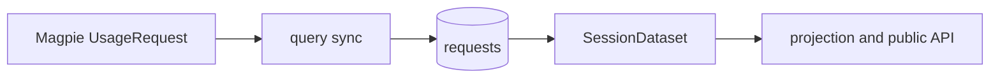

# 1. 文档目的

Magpie 逐请求 `cost` 和 `priced` 是 Usagi 的唯一金额来源。本方案删除本地计价链，并让 schema 4 数据库升级时校准已存日期，失败后可继续重试。

# 2. 代码现状与问题

仓库为 `github.com/Hogeexxl/Usagi`，基线分支为 `main`，提交为 `5fb3f7bc51b3f8347411471c01a33bab0838f0e7`，数据库版本为 schema 4。

- `SessionDataset` 用本地价格目录覆盖上游金额；`syncPricing` 读取 `/api/providers` 并下载 models.dev 目录。
- 冻结日期发现摘要变化时只记录差异，不刷新该日金额。
- 日汇总相同但逐请求价格变化时，现有摘要无法检测；本方案接受该限制。
- `requests.magpie_cost` 和 `requests.magpie_priced` 已保存上游金额，可直接作为唯一金额来源。

# 3. 目标架构与范围边界

## 3.1 目标效果与终态

Magpie 的 `UsageRequest.cost` 和 `UsageRequest.priced` 原样写入请求表。
`SessionDataset` 原样读取这两个字段，token 明细仍在本地存储和汇总。
同步链路不再访问 `/api/providers` 或 models.dev。
数据库只保留请求金额字段，不含价格目录表。

## 3.2 范围矩阵

| 维度 | 纳入范围 | 严格排除 |
|---|---|---|
| 模块 / 文件 | `internal/query`、`internal/database`、`internal/magpie` 计价读取链、受影响测试、实际执行的安装/冒烟夹具、本文件 | `frontend`、订阅计费、UI、Magpie 源码、其他方案文档 |
| 功能 / 逻辑 | 上游金额传递、历史校准、schema 4 到 5、价格表删除、providers 定价链删除 | 新价格表、价格快照、Magpie 刷新定时器、定时全量扫描、新上游接口、新依赖 |

# 4. 架构契约与核心不变量

## 4.1 架构不变量

`[INV-01]` 唯一金额源：请求金额和计价状态只能来自 Magpie 的逐请求 `cost` 和 `priced`；Usagi 不得重算金额或建立本地价格目录。

`[INV-02]` 原值语义：金额按浮点值原样存储、读取和汇总；`priced=false` 保留 false 和上游金额；零 token 请求也遵循上游值。

`[INV-03]` 原子替换：日同步先完整读取，再在一个事务中替换该日请求和同步状态；该日失败时保留旧请求、旧同步状态和 revision，其他已成功同步仍可推进 revision。

`[INV-04]` 单次校准：升级前已存日期应在无指纹时校准一次；失败时保留无指纹状态供下次重试；成功后写入新指纹，摘要可用且无变化时不得重拉。

`[INV-05]` 请求数稳定：普通同步不得增加上游请求数；校准只重拉目标日期，不得新增定时全量扫描。

`[INV-06]` 明细保留：删除价格表不得删除或改写请求、token、session 和关联明细；`sync_days` 可迁移指纹等同步元数据。

`[INV-07]` 已知边界：日汇总完全相同但逐请求价格互换时，摘要无法发现；Usagi 不保存逐请求历史快照。

## 4.2 数据模型契约

`requests.magpie_cost REAL NOT NULL DEFAULT 0` 保存 Magpie 金额；`requests.magpie_priced INTEGER NOT NULL DEFAULT 0` 保存计价状态，`0` 为 false，`1` 为 true。
最终数据库不得包含 `price_versions` 或 `prices` 表。
`sync_days.fingerprint` 保持可空；schema 5 升级清空所有已存指纹。无指纹即待校准状态，不新增列。

## 4.3 接口契约

公开产品接口和 DTO 不变；`UsageRequest.Cost`、`UsageRequest.Priced`、`UsageRow.Cost` 和 `UsageRow.Priced` 保持现有类型和语义。
删除 `internal/magpie.Client.Providers`、`ProviderCatalog`、`ProviderCatalogsResponse` 及查询层转发。

## 4.4 状态机

| 当前状态 | 触发事件 | 目标状态 | 校验条件 |
|---|---|---|---|
| 无指纹 | 日历日读取成功 | 有指纹 | 请求和同步状态同事务提交 |
| 无指纹 | 日历日读取或保存失败 | 无指纹 | 该日旧请求、旧状态和 revision 不变 |
| 有指纹 | 日摘要可用且未变化 | 有指纹 | 不读取该日请求 |
| 有指纹 | 日摘要变化 | 有指纹 | 完整读取后替换该日，包括冻结日期 |

无指纹状态包含冻结日期，允许失败后重启继续校准。

# 5. 施工路线

查询、同步与迁移共用同一链路顺序完成。

# 6. 详细实施步骤

## 6.1 原样传递金额并刷新变化日期

目标文件：`internal/query/sessions.go`、`internal/query/sync.go` `[修改]`。

1. 删除 `pricing.Load`、金额清零和 token 门槛重算。
2. 删除 `syncPricing`、`providerCatalogsOf` 及其调用。
3. 日期枚举并入 `sync_days` 已存日期，并去重排序。
4. 无指纹日期进入目标集，包含冻结日期。
5. 冻结日期有指纹且摘要变化时进入目标集；摘要可用且未变化时跳过。
6. 保留 `saveSyncDay` 的整日事务替换、失败回滚和单次 revision 递增。

目标文件：`internal/query/sessions_dataset_test.go`、`internal/query/sync_test.go` `[修改]`。
覆盖原值金额、false、零 token、冻结日仅金额变化、摘要可用且无变化不重拉、失败保留与重启重试、成功不重复校准、上游 `series` 缺日。

## 6.2 增加 schema 5 迁移

目标文件：`internal/database/db.go` `[修改]`，遵循 `[INV-03]`、`[INV-04]`、`[INV-06]`。

1. 在 schema 4 分支调用 `migrateV4ToV5`，并保留 schema 1 到 4 的历史迁移。
2. 删除 `prices`，再删除 `price_versions`。
3. 清空 `sync_days.fingerprint`，把 `schema_version` 更新为 `5`。
4. 保持 `schema.sql` 的 schema 1 起点，让新库经顺序迁移得到 schema 5。

目标文件：`internal/database/db_test.go` `[修改]`。
覆盖 schema 4 升级保留请求和 token 明细、删除价格表、清空指纹；覆盖新库最终 schema 5；覆盖迁移失败回滚。

## 6.3 清理废弃计价链路

目标文件：`internal/pricing/` `[删除]`。

目标文件：`internal/magpie/client.go` `[修改]`、`internal/magpie/types_providers.go` `[删除]`、`internal/query/service.go`、`internal/query/runtime_upstream.go` `[修改]`。
删除 `Providers` 方法、DTO、接口项、运行时转发、`pricingHTTPClient` 和对应测试。

目标文件：query/projection 受影响测试、实际执行旧价格表的安装或冒烟夹具 `[修改]`。
把金额直接写入请求字段，删除旧价格表夹具；保留其他 identity、compaction、request metrics 和 projection 语义。
安装/冒烟脚本迁移时把 schema 断言改为 `5`，删除 `/api/providers` 请求断言。

## 6.4 定向验收

运行 `go test ./internal/query ./internal/database ./internal/magpie ./internal/projection`，以及直接受影响调用方的编译或脚本检查。
活动 Go 源码不得含旧计价符号。
定向测试全部通过后，等待独立验收代理执行一次 `go test ./...`。

# 7. 测试与机器验收

## 7.1 自动化测试

| 验证项 | 通过标准 |
|---|---|
| 查询与同步 | 金额原样传递、false 和零 token 语义正确；冻结日摘要变化刷新；摘要可用且无变化不重拉；校准失败可重试且成功不重复 |
| 数据库迁移 | schema 4 到 5 保留明细、删除价格表、清空指纹；新库最终 schema 5；失败回滚 |
| Magpie 客户端 | provider 定价路径不存在，其他客户端行为不变 |
| 投影 | 请求金额进入投影汇总，原有 identity、compaction、metrics 语义不变 |
| 直接调用方 | 实际执行旧价格表的安装/冒烟夹具已迁移并完成对应检查 |

## 7.2 验收门禁

1. 定向 Go 测试命令以退出码 0 结束。
2. schema 4 测试库升级后版本为 `5`，请求和 token 明细保留，价格表不存在。
3. 新库版本为 `5`，价格表不存在。
4. 活动 Go 源码不含 `internal/pricing`、`syncPricing`、`ProviderCatalogsResponse` 或 models.dev 请求。
5. `frontend` 不改动，现有未计价提示保持原逻辑。

## 7.3 已知限制

日汇总完全相同但逐请求价格互换时，Usagi 无法检测该变化；本次不保存逐请求历史快照。
